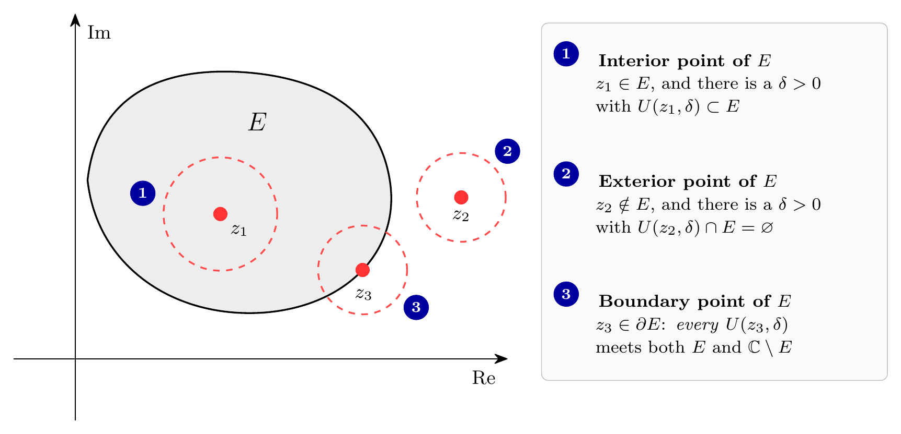
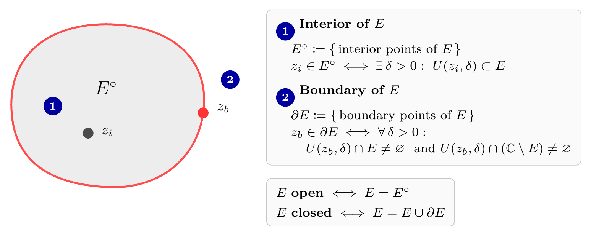
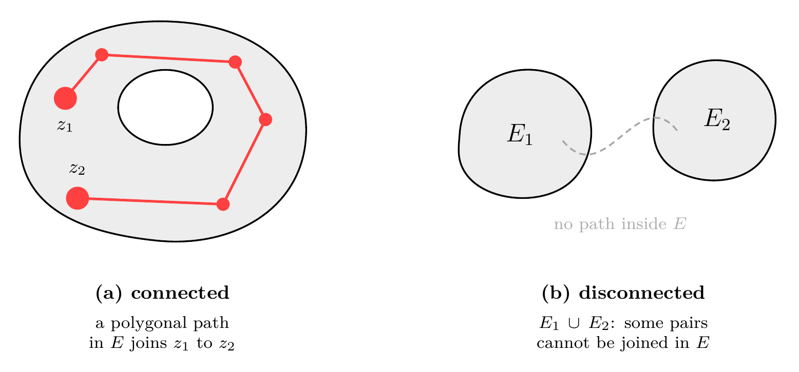
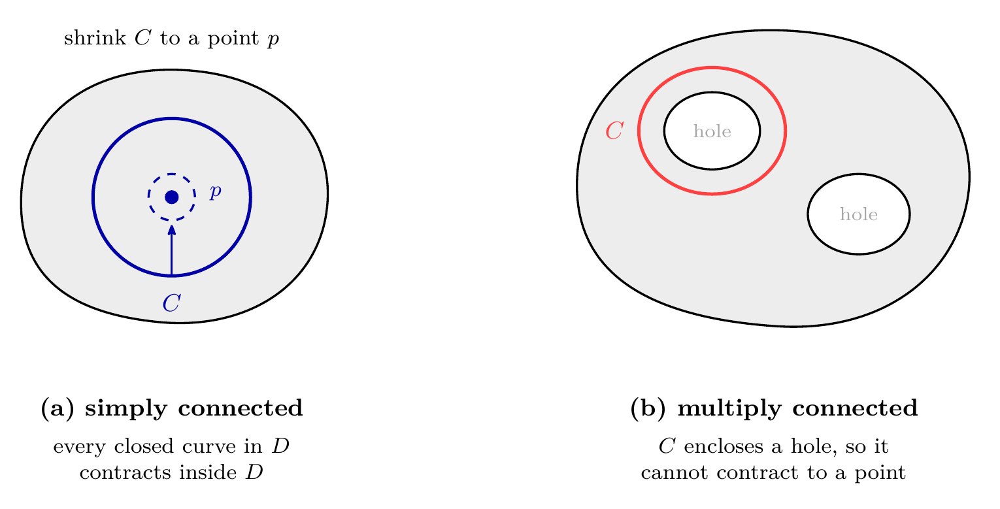
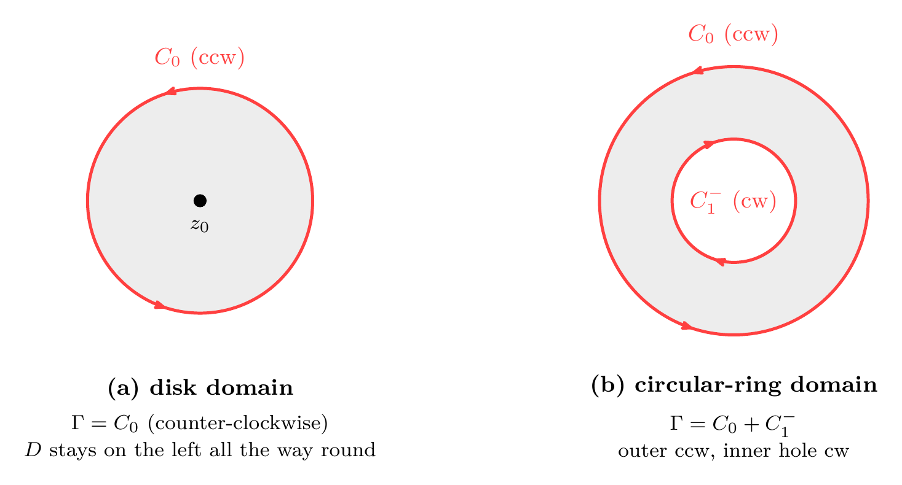
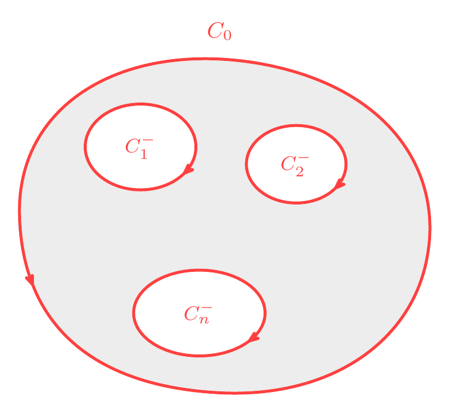
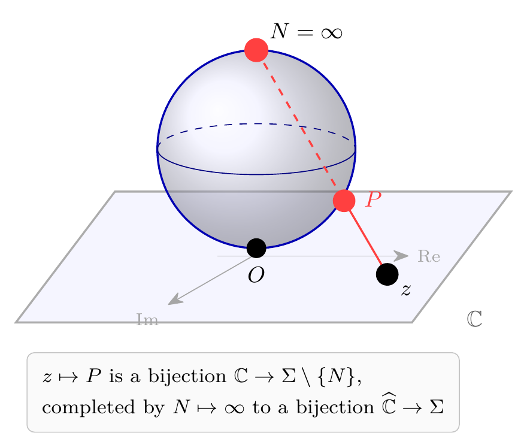

# Lecture 2: Point Sets in the Complex Plane

Lecture 1 treated a complex number as a single object. The present chapter instead studies **subsets** of $\mathbb{C}$: disks, open and closed sets, connected sets, and the domains on which complex functions will be defined. The properties involved --- openness, connectedness, boundary --- refer to the position of the points of a set in the plane, and are not expressed through the algebra of complex numbers.

## 1. Neighborhoods

The basic measuring tool is the open disk.

A **$\delta$-neighborhood** of a point $z_0 \in \mathbb{C}$ is the open disk

$$
U(z_0, \delta) \coloneqq \{z \in \mathbb{C} : \vert{}z - z_0\vert{} < \delta\}, \quad \delta > 0 \tag{1}
$$

Its boundary circle $\vert{}z - z_0\vert{} = \delta$ is **not** part of $U(z_0, \delta)$. Removing the centre as well gives the **punctured (deleted) neighborhood**

$$
\mathring{U}(z_0, \delta) \coloneqq \{z \in \mathbb{C} : 0 < \vert{}z - z_0\vert{} < \delta\} \tag{2}
$$

which is the natural setting for limits, where the value at $z_0$ itself must not influence the behaviour.

Every definition in this chapter has one of two logical forms: it requires a property to hold *for all sufficiently small $\delta > 0$*, or it requires the existence of *at least one $\delta > 0$* with that property. Distinguishing the two forms is the main point of the definitions that follow.

## 2. Interior, Exterior and Boundary Points

> **Remark 1 (Complement).** The **complement** of $E$ in $\mathbb{C}$ is the set of points of the plane that do not belong to $E$:
>
> $$
> \mathbb{C} \setminus E \coloneqq \{z \in \mathbb{C} : z \notin E\} \tag{3}
> $$
>
> The complement is defined relative to the ambient set $\mathbb{C}$, so $E \cup (\mathbb{C} \setminus E) = \mathbb{C}$ and $E \cap (\mathbb{C} \setminus E) = \varnothing$. The notation below uses it only in this sense.

Let $E \subset \mathbb{C}$ be a point set and $z_0 \in \mathbb{C}$. Relative to $E$, the point $z_0$ is exactly one of the following.

1. **Interior point:** $z_0 \in E$ and there is a $\delta > 0$ such that

   $$
   U(z_0, \delta) \subset E \tag{4}
   $$

2. **Exterior point:** there is a $\delta > 0$ such that

   $$
   U(z_0, \delta) \cap E = \varnothing \tag{5}
   $$

3. **Boundary point:** for **every** $\delta > 0$,

   $$
   U(z_0, \delta) \cap E \ne \varnothing \quad \text{and} \quad U(z_0, \delta) \cap (\mathbb{C} \setminus E) \ne \varnothing \tag{6}
   $$

The interior point $z_1$ has a whole disk that stays inside $E$; the exterior point $z_2$ has a whole disk that avoids $E$; the boundary point $z_3$ has no such disk --- every disk around it is split between $E$ and its complement. Note:

* The three cases are **mutually exclusive and exhaustive**: every point of $\mathbb{C}$ is interior, exterior, or boundary.
* An interior point necessarily lies in $E$, and an exterior point necessarily lies outside $E$; a boundary point may lie either in $E$ or outside it. The boundary is therefore *not* required to belong to $E$ or to $\mathbb{C} \setminus E$.
* An **isolated point** of $E$ (a point of $E$ with some $\mathring{U}(z_0, \delta) \cap E = \varnothing$) is always a boundary point, because $U(z_0, \delta)$ still meets $E$ at $z_0$ itself.

## 3. Boundary, Interior, Open and Closed Sets

Collecting the three kinds of points gives three sets.

$$
E^{\circ} \coloneqq \{z : z \text{ is an interior point of } E\} \tag{7}
$$

$$
\partial E \coloneqq \{z : z \text{ is a boundary point of } E\} \tag{8}
$$

$$
\operatorname{ext} E \coloneqq \{z : z \text{ is an exterior point of } E\} \tag{9}
$$

$E^{\circ}$ is the **interior** of $E$ and $\partial E$ is the **boundary** of $E$. By (9), the exterior is just the interior of the complement, $\operatorname{ext} E = (\mathbb{C} \setminus E)^{\circ}$. Adding the boundary to $E$ produces the **closure**

$$
\overline{E} \coloneqq E \cup \partial E \tag{10}
$$

which is the smallest closed set containing $E$.

A set is classified by how much of its own boundary it carries.

* $E$ is **open** if and only if every one of its points is interior, i.e.

  $$
  E \ \text{open} \iff E = E^{\circ} \tag{11}
  $$

* $E$ is **closed** if and only if it contains its whole boundary, i.e.

  $$
  E \ \text{closed} \iff E = \overline{E} = E \cup \partial E \tag{12}
  $$

* Equivalently, $E$ is closed exactly when its complement is open:

  $$
  E \ \text{closed} \iff \mathbb{C} \setminus E \ \text{open} \tag{13}
  $$

The two notions are not opposites. Take $E = \{z : \vert{}z\vert{} < 1\} \cup \{1\}$: the point $1$ lies in $E$ but has no neighborhood inside $E$, so $E$ is not open, while $\partial E = \{z : \vert{}z\vert{} = 1\}$ is not contained in $E$, so $E$ is not closed either. "Open" forbids boundary points, "closed" demands all of them, and a set may fail both tests at once. Note that a circle $\{z : \vert{}z\vert{} = 1\}$, taken as a set of points, *is* closed --- it equals its own boundary --- although it has empty interior.

Two facts follow immediately from the last definitions: $E$ is open $\iff$ $\partial E \cap E = \varnothing$, and $E$ is closed $\iff$ $\partial E \subset E$. Also $\partial E = \partial(\mathbb{C} \setminus E)$: the boundary is shared between a set and its complement.

## 4. Connected Sets

A set either is of one piece or falls apart into several. **Connectedness** is the formal expression of the first alternative: any two of its points can be joined without leaving the set.

A **polygonal path** in $E$ joining $z_1$ and $z_2$ is a union of finitely many segments whose vertices start at $z_1$ and end at $z_2$:

$$
\gamma = \bigcup_{k=1}^{n} [w_{k-1}, w_k], \qquad w_0 = z_1, \quad w_n = z_2, \quad [w_{k-1}, w_k] \subset E \tag{14}
$$

$E$ is **connected** if every two of its points can be so joined:

$$
E \ \text{connected} \iff \forall\, z_1, z_2 \in E \ \ \exists\, \gamma \subset E \ \text{joining} \ z_1 \ \text{to} \ z_2 \tag{15}
$$

In panel (a) the region is not simply shaped, yet it remains **connected**, since the polygonal path joining $z_1$ to $z_2$ avoids the hole. A hole therefore does not destroy connectedness; only a genuine separation does, as in panel (b), where $E_1 \cup E_2$ falls into two components and no path inside the set joins them.

## 5. Domains and Connectivity

Combining the last two sections gives the central object of the whole course.

A **domain** (or **region**) $D$ is a point set that is both open and connected:

$$
D \ \text{domain} \iff D \ \text{open and connected} \tag{16}
$$

Openness is what makes differentiation possible on a domain, while connectedness excludes a domain that falls into unrelated components. A domain is **bounded** if $D \subset U(0, R)$ for some $R > 0$, and **unbounded** otherwise. A domain together with its boundary, $\overline{D} = D \cup \partial D$, is called a **closed domain**.

Every domain is an open set, but the converse fails: for $z_0 \ne z_1$ the set $U(z_0, \delta) \cup U(z_1, \delta)$ is open and yet is not a domain, being disconnected. Openness is a *local* property, verified one neighborhood at a time; being a domain also requires the *global* property that the set be of one piece.

Domains are further distinguished by the number of holes they enclose. $D$ is **simply connected** if every closed curve in $D$ can be shrunk continuously to a single point without ever leaving $D$:

$$
C \subset D, \ C \ \text{a closed curve} \ \Longrightarrow \ C \ \text{contracts to a point inside} \ D \tag{17}
$$

Otherwise $D$ is **multiply connected**.

In panel (a) the curve $C$ contracts within $D$ to a point $p \in D$. In panel (b) the curve $C$ encircles a hole; contracting it to a point would require it to cross that hole, which does not belong to $D$. A simply connected domain is thus one without holes, equivalently one whose complement $\mathbb{C} \setminus D$ has no bounded component.

The two notions must be kept apart. An annulus is connected, since any two of its points can be joined by a path inside it, yet it is multiply connected. Connectedness concerns the existence of paths between points; simple connectedness concerns the contractibility of closed curves.

## 6. Positive Orientation of the Boundary

For a domain with holes, or an unbounded domain, the boundary $\partial D$ may consist of several separate closed curves. Integration over $\partial D$ requires these curves to be traversed in a coherent order.

The **positively oriented boundary** $\Gamma^{+}$ of a domain $D$ is the traversal of $\partial D$ for which the domain stays on the **left**:

$$
\Gamma^{+} : \quad D \ \text{lies to the left of the direction of travel} \tag{18}
$$

The opposite traversal is written $\Gamma^{-}$.

For a disk domain there is a single boundary curve, and the rule forces it to be counterclockwise:

$$
\Gamma = C_0 \quad (\text{counterclockwise}) \tag{19}
$$

For a circular-ring domain the boundary has two components, and the rule forces opposite senses: the outer circle counterclockwise, the inner circle clockwise.

$$
\Gamma = C_0 + C_1^{-} \quad (\text{outer ccw}, \ \text{inner cw}) \tag{20}
$$

Here the superscript minus in $C_1^{-}$ denotes traversal in the reversed, clockwise sense. This is the unique choice for which $D$ lies to the left along **every** component, so that the several curves combine into a single positively oriented boundary instead of partly cancelling each other.

The same rule extends to a domain with $n$ holes, giving one outer curve and $n$ inner curves:

$$
\Gamma = C_0 + C_1^{-} + C_2^{-} + \cdots + C_n^{-} \tag{21}
$$

## 7. The Extended Complex Plane

The complex plane is not compact, and a sequence such as $z_k = k$ has no limit in $\mathbb{C}$. Adjoining a single ideal point repairs this.

The **extended complex plane** is

$$
\widehat{\mathbb{C}} \coloneqq \mathbb{C} \cup \{\infty\} \tag{22}
$$

We write $\vert{}\infty\vert{} = +\infty$, but no arithmetic is defined for $\infty$: expressions such as $\infty - \infty$ or $0 \cdot \infty$ remain meaningless. The point $\infty$ is a *location*, not a number.

A set of the form

$$
\{z \in \mathbb{C} : \vert{}z\vert{} > R\} \cup \{\infty\}, \quad R > 0 \tag{23}
$$

is a **neighborhood of $\infty$**. With this definition $\infty$ behaves like any other point of $\widehat{\mathbb{C}}$: it has neighborhoods, and a sequence diverges to $\infty$ exactly when it eventually lies in every such neighborhood. A set $E \subset \mathbb{C}$ is bounded precisely when its closure in $\widehat{\mathbb{C}}$ does not contain $\infty$.

The geometric model of $\widehat{\mathbb{C}}$ is the **Riemann sphere**. Take the unit sphere

$$
\Sigma : \ X^2 + Y^2 + Z^2 = 1 \tag{24}
$$

and identify the plane $\mathbb{C}$ with the equatorial plane $Z = 0$. **Stereographic projection** sends $z = x + \mathrm{i} y$ to the point where the line from the north pole $N = (0,0,1)$ through $(x,y,0)$ meets $\Sigma$:

$$
X = \frac{2x}{1 + \vert{}z\vert{}^2}, \quad
Y = \frac{2y}{1 + \vert{}z\vert{}^2}, \quad
Z = \frac{\vert{}z\vert{}^2 - 1}{1 + \vert{}z\vert{}^2} \tag{25}
$$

The map is a bijection from $\mathbb{C}$ onto $\Sigma \setminus \{N\}$. The inverse is

$$
x = \frac{X}{1 - Z}, \quad y = \frac{Y}{1 - Z} \tag{26}
$$

and completing it by $N \mapsto \infty$ extends the correspondence to all of $\widehat{\mathbb{C}}$:

$$
\widehat{\mathbb{C}} \ \longleftrightarrow \ \Sigma, \qquad \infty \ \longleftrightarrow \ N \tag{27}
$$

Since the map is continuous in both directions, $\widehat{\mathbb{C}}$ may be read as $\Sigma$ and questions about $\infty$ become questions about the north pole. This is what makes it possible to treat $\infty$ as an ordinary point of the plane's compactification rather than as a separate exception.

Two consequences are used later. First, a circle $\vert{}z\vert{} = R$ in the plane corresponds to a circle of latitude on the sphere,

$$
\vert{}z\vert{}^2 = \frac{1 + Z}{1 - Z} \quad \Longleftrightarrow \quad Z = \frac{R^2 - 1}{R^2 + 1} \tag{28}
$$

so that $R \uparrow \infty$ drives $Z \uparrow 1$: the exterior of a large circle is exactly a small neighborhood of the north pole. Second, lines in the plane correspond to circles on $\Sigma$ passing through $N$, so on the sphere "circle" and "line" merge into a single notion --- the generalized circle.

## 8. Worked Examples

Two loci are examined below. In each case the defining condition is reduced to a system of inequalities between moduli, from which the boundary and the connectivity of the set can be read off.

### 8.1 A Lune Bounded by Two Tangent Circles

**Example 1** (cf. the exercise $r = \cos\theta$, $r = 2\cos\theta$). Determine the set

$$
D \coloneqq \{z = r\mathrm{e}^{\mathrm{i}\theta} : \cos\theta < r < 2\cos\theta\} \tag{29}
$$

and describe its boundary and connectivity.

*Solution.* The constraint $\cos\theta > r \ge 0$ forces $\cos\theta > 0$, so the relevant angular range is $\theta \in (-\frac{\mathrm{\pi}}{2}, \frac{\mathrm{\pi}}{2})$. Multiply the polar equations by $r > 0$ and use $r^2 = x^2 + y^2$, $r\cos\theta = x$. The outer curve becomes

$$
r = 2\cos\theta \iff r^2 = 2r\cos\theta \iff x^2 + y^2 = 2x \iff \vert{}z - 1\vert{} = 1 \tag{30}
$$

and the inner curve becomes

$$
r = \cos\theta \iff r^2 = r\cos\theta \iff x^2 + y^2 = x \iff \left\vert{}z - \tfrac{1}{2}\right\vert{} = \tfrac{1}{2} \tag{31}
$$

These are the circles of diameter $[0,2]$ and $[0,1]$, both passing through the origin, where they are internally tangent. Hence

$$
D = \{z : \vert{}z - 1\vert{} < 1\} \cap \left\{z : \left\vert{}z - \tfrac{1}{2}\right\vert{} > \tfrac{1}{2}\right\} \tag{32}
$$

the open lune between the two circles.

**Conclusion.** $D$ is a **domain**: it is open (both inequalities are strict) and connected. It is **bounded**, since $D \subset U(0,2)$. And it is **simply connected**: the excluded disk $\left\vert{}z - \frac{1}{2}\right\vert{} \le \frac{1}{2}$ touches the outer circle at the single point $0$, so it is attached to the exterior of $D$ rather than trapped inside it --- the complement of $D$ is connected, and $D$ has no hole. The boundary $\partial D = \Gamma_1 \cup \Gamma_2$ is the union of the two full circles $\Gamma_1 : \left\vert{}z - \frac{1}{2}\right\vert{} = \frac{1}{2}$ and $\Gamma_2 : \vert{}z - 1\vert{} = 1$.

### 8.2 An Angular Locus

**Example 2** (cf. the exercise $0 < \arg\frac{z - \mathrm{i}}{z + \mathrm{i}} < \frac{\mathrm{\pi}}{4}$). Determine the set

$$
D \coloneqq \left\{z : 0 < \arg\frac{z - \mathrm{i}}{z + \mathrm{i}} < \frac{\mathrm{\pi}}{4}\right\} \tag{33}
$$

and describe its boundary and connectivity.

*Solution.* Let $\alpha \in (0, \frac{\mathrm{\pi}}{2})$ and consider the locus $\arg\frac{z - \mathrm{i}}{z + \mathrm{i}} = \alpha$. This is the set of points at which the segment from $-\mathrm{i}$ to $+\mathrm{i}$ is seen under the angle $\alpha$. By the inscribed-angle theorem --- the same circle geometry that gave Thales's theorem in Lecture 1 --- a fixed chord is seen under a fixed angle exactly on an **arc of a circle** through its endpoints, and the circle is determined by requiring the central angle to be $2\alpha$.

For $\alpha = \frac{\mathrm{\pi}}{4}$ the chord $[-\mathrm{i}, \mathrm{i}]$ has length $2$, so the circle has radius $R$ with $2R\sin\frac{\mathrm{\pi}}{4} = 2$, giving $R = \sqrt{2}$. Its centre lies on the real axis, and passing through $\pm\mathrm{i}$ forces the centre to be $-1$:

$$
\vert{}z + 1\vert{} = \sqrt{2} \tag{34}
$$

This circle passes through $\pm \mathrm{i}$ (since $\vert{}\pm\mathrm{i} + 1\vert{} = \sqrt{2}$) and meets the real axis at $-1 \pm \sqrt{2}$. The limiting case $\alpha = 0$ degenerates to the chord's own line, namely the imaginary axis, minus the segment between the endpoints.

Collecting both pieces, the lower bound $\alpha > 0$ keeps $z$ on the side of the imaginary axis where the angle is measured positively, and the upper bound $\alpha < \frac{\mathrm{\pi}}{4}$ keeps $z$ outside the disk:

$$
D = \{z : \operatorname{Re} z < 0\} \cap \{\vert{}z + 1\vert{} > \sqrt{2}\} \tag{35}
$$

**Conclusion.** $D$ is a **domain**: open (strict inequalities) and connected --- the disk $\vert{}z + 1\vert{} \le \sqrt{2}$ cuts a cap out of the left half-plane, but that cap is attached to the boundary line, so $D$ remains one piece. It is **unbounded**, since it contains every $z = -R$ with $R > 1 + \sqrt{2}$. It is **simply connected**: the removed cap touches $\partial D$ along the imaginary axis, so again no hole is enclosed.

The boundary $\partial D = \Gamma_1 \cup \Gamma_2$ consists of the two rays of the imaginary axis outside the chord,

$$
\Gamma_1 : \ \operatorname{Re} z = 0, \ \vert{}\operatorname{Im} z\vert{} \ge 1 \tag{36}
$$

together with the major arc of the circle (34) that lies in the closed left half-plane,

$$
\Gamma_2 : \ \vert{}z + 1\vert{} = \sqrt{2}, \ \operatorname{Re} z \le 0 \tag{37}
$$

and the positively oriented boundary traverses both rays of $\Gamma_1$ **upwards**, then runs along $\Gamma_2$ from $-\mathrm{i}$ around $-1 - \sqrt{2}$ to $+\mathrm{i}$, keeping $D$ on the left throughout. Traversed the other way round, $D$ would fall on the right, so the orientation is forced.