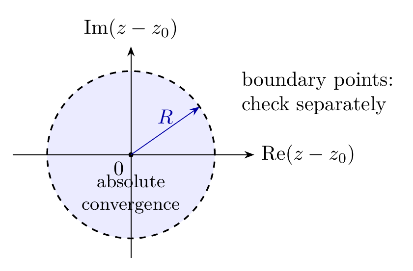

# Mathematics Method for Physics - Lecture 8

**Complex Series: Preliminaries**

Instructor: Zhaolong Han, SOCE, Shanghai Jiao Tong University

Email: han.arkey@sjtu.edu.cn

Complex series extend real-series convergence to the complex plane. Power series have an especially useful geometry: their interior convergence region is a disk. We use that fact to justify algebraic operations and differentiation, then derive Taylor's theorem from Cauchy's integral formula.

## 1. Complex Series

**Definition 1 (Convergence of a complex series).**

For a sequence $z_n\in\mathbb{C}$, the series $\sum_{n=1}^{\infty}z_n$ converges to $S$ if its partial sums

$$
S_N\coloneqq \sum_{n=1}^{N}z_n
 \quad\hbox{satisfy}\quad \lim_{N\to\infty}S_N=S\in\mathbb{C}.
\tag{1}
$$

Otherwise it diverges. A finite complex limit is required.

### 1.1 The geometric series

For $z\neq1$,

$$
\sum_{k=0}^{N}z^k\equiv \frac{1-z^{N+1}}{1-z}.
\tag{2}
$$

When $|z|<1$, $z^{N+1}\to0$, giving

$$
\boxed{\frac1{1-z}\equiv \sum_{n=0}^{\infty}z^n,\qquad |z|<1.}
\tag{3}
$$

For $|z|\geq1$, the terms do not tend to zero, so the series diverges. More generally,

$$
\frac1{a-b}=\frac1a\sum_{n=0}^{\infty}\left(\frac ba\right)^n,
 \qquad |b|<|a|.
\tag{4}
$$

### 1.2 Basic convergence facts

-  Convergence implies $z_n\to0$. The converse is false; for example,
$\sum_{n=1}^{\infty}1/n$ diverges.

-  If $z_n=\alpha_n+\mathrm{i}\beta_n$, then $\sum z_n$ converges if and only if
both real series $\sum\alpha_n$ and $\sum\beta_n$ converge.

-  **Definition (absolute convergence).** If $\sum|z_n|<\infty$, then $\sum z_n$ converges absolutely.
A convergent series that is not absolutely convergent is called conditionally convergent.

The real-series convergence tests can thus be applied to $\sum |z_n|$. The componentwise statement follows by taking real and imaginary parts of the partial sums. Absolute convergence implies that both component series are absolutely convergent, since $|\alpha_n|,|\beta_n|\leq|z_n|$.

## 2. Power Series and the Radius of Convergence

**Definition 2 (Power series).**

A power series centered at $z_0$ has the form

$$
\sum_{n=0}^{\infty}c_n(z-z_0)^n.
\tag{5}
$$

**Theorem 1 (Abel's convergence result).**

Initially take $z_0=0$. Abel's convergence result states:

-  convergence at $z_1\neq0$ implies absolute convergence for
every $|z|<|z_1|$;

-  divergence at $z_2$ implies divergence for every $|z|>|z_2|$.

For the first claim, convergence at $z_1$ makes $c_n z_1^n$ bounded, say by $M$. If $|z|<|z_1|$, then

$$
|c_nz^n|\leq M\left|\frac z{z_1}\right|^n,
\tag{6}
$$

and comparison with a geometric series proves absolute convergence. For the second claim, convergence at a point of larger modulus would, by the first claim, force convergence at $z_2$, a contradiction.

**Definition 3 (Radius of convergence).**

There is a radius $R\in[0,\infty]$ such that the power series converges absolutely for $|z-z_0|<R$ and diverges for $|z-z_0|>R$.

**Remark.** Points on $|z-z_0|=R$ must be checked separately. If $R=0$, only the center is included; if $R=\infty$, the series converges everywhere.

*Disk of absolute convergence; boundary points require separate tests.*

The general radius formula is

$$
\boxed{\frac1R=\limsup_{n\to\infty}|c_n|^{1/n}.}
\tag{7}
$$

If either of the following limits exists, it may be used instead:

$$
R=\frac1{\displaystyle\lim_{n\to\infty}|c_n|^{1/n}},
 \qquad
 R=\frac1{\displaystyle\lim_{n\to\infty}|c_{n+1}/c_n|}.
\tag{8}
$$

**Remark.** The ratio expression assumes the ratios are eventually defined. We use $1/0=\infty$ and $1/\infty=0$ for these formulas.

## 3. Operations on Power Series

Power series converge uniformly on every closed disk strictly inside their disk of convergence. This is the condition that justifies the following operations in the common interior disk. For example, choose
$0<r<\rho<R$. Convergence at $\rho$ makes $|c_n|\rho^n$ bounded,
so $|c_nz^n|\leq M(r/\rho)^n$ on $|z|\leq r$. The geometric majorant gives uniform convergence on that closed disk.

For $A(z)=\sum a_nz^n$ and $B(z)=\sum b_nz^n$,

$$
\begin{aligned}
 A(z)\pm B(z)&=\sum_{n=0}^{\infty}(a_n\pm b_n)z^n,\\
 A(z)B(z)&=\sum_{n=0}^{\infty}
     \left(\sum_{k=0}^{n}a_kb_{n-k}\right)z^n.
\end{aligned}
\tag{9}
$$

The second formula is the Cauchy product.

If $b_0\neq0$, the quotient has a Taylor series in a sufficiently small disk about $0$. Writing $A/B=\sum d_nz^n$ and comparing coefficients gives

$$
d_0=\frac{a_0}{b_0},\qquad
 d_n=\frac{a_n-\sum_{k=1}^{n}b_kd_{n-k}}{b_0}\quad(n\geq1).
\tag{10}
$$

This series represents $A/B$ on any centered disk on which $A,B$ are holomorphic and $B$ has no zeros. Its convergence need not extend to the whole common disk of $A$ and $B$: zeros of $B$ can obstruct it.

For $f(z)=\sum_{n=0}^{\infty}c_nz^n$ with radius $R$,

$$
f'(z)=\sum_{n=1}^{\infty}n c_n z^{n-1},
 \qquad
 \int_0^z f(\zeta)\,\mathrm{d}\zeta
    =\sum_{n=0}^{\infty}\frac{c_n}{n+1}z^{n+1},
 \qquad |z|<R.
\tag{11}
$$

Both new power series have the same radius $R$. The integral can be taken along any path from $0$ to $z$ lying inside the disk.

## 4. Taylor's Theorem

**Theorem 2 (Taylor expansion).**

If $f$ is holomorphic in $|z-z_0|<R$, it has a unique expansion

$$
\boxed{f(z)=\sum_{n=0}^{\infty}c_n(z-z_0)^n,\qquad
 c_n\coloneqq\frac{f^{(n)}(z_0)}{n!},\quad |z-z_0|<R.}
\tag{12}
$$

For any positively oriented circle $C_\rho:|\zeta-z_0|=\rho<R$,

$$
c_n=\frac1{2\pi \mathrm{i}}\oint_{C_\rho}
              \frac{f(\zeta)}{(\zeta-z_0)^{n+1}}\,\mathrm{d}\zeta.
\tag{13}
$$

**Remark.** The case $z_0=0$ is called the Maclaurin expansion.

### 4.1 Proof from Cauchy's integral formula

Fix $z$ and choose $|z-z_0|<\rho<R$. On $C_\rho$,

$$
\frac1{\zeta-z}
 =\frac1{\zeta-z_0}
    \frac1{1-(z-z_0)/(\zeta-z_0)}
 =\sum_{n=0}^{\infty}
       \frac{(z-z_0)^n}{(\zeta-z_0)^{n+1}}.
\tag{14}
$$

The ratio has constant modulus $|z-z_0|/\rho<1$ on the integration circle, so this geometric series is uniformly convergent there. Cauchy's formula and termwise integration yield

$$
\begin{aligned}
 f(z)&=\frac1{2\pi \mathrm{i}}\oint_{C_\rho}
                         \frac{f(\zeta)}{\zeta-z}\,\mathrm{d}\zeta\\
 &=\sum_{n=0}^{\infty}
    \left[\frac1{2\pi \mathrm{i}}\oint_{C_\rho}
       \frac{f(\zeta)}{(\zeta-z_0)^{n+1}}\,\mathrm{d}\zeta\right](z-z_0)^n.
\end{aligned}
\tag{15}
$$

The higher-order Cauchy formula identifies the bracket as
$f^{(n)}(z_0)/n!$. Termwise differentiation at $z_0$ also shows that
these coefficients are unique.

The same argument gives an explicit remainder estimate. Let
$M_\rho\coloneqq\max_{|\zeta-z_0|=\rho}|f(\zeta)|$. The finite geometric
identity in Cauchy's formula yields

$$
\left|f(z)-\sum_{n=0}^{N}c_n(z-z_0)^n\right|
 \leq\frac{M_\rho\rho}{\rho-|z-z_0|}
       \left(\frac{|z-z_0|}{\rho}\right)^{N+1}.
\tag{16}
$$

The right-hand side tends to zero because $|z-z_0|<\rho$.

Conversely, a convergent power series is holomorphic in its disk of convergence. Thus a function is holomorphic on a domain if and only if it has a convergent power-series representation in a neighborhood of each point of that domain. A single series about one point need not represent the function throughout an arbitrary domain.

### 4.2 Standard expansions

$$
\begin{aligned}
 e^z&=\sum_{n=0}^{\infty}\frac{z^n}{n!},
 &\sin z&=\sum_{n=0}^{\infty}\frac{(-1)^nz^{2n+1}}{(2n+1)!},\\
 \cos z&=\sum_{n=0}^{\infty}\frac{(-1)^nz^{2n}}{(2n)!}.
\end{aligned}
\tag{17}
$$

These three series converge for every $z\in\mathbb{C}$. For $|z|<1$,

$$
\begin{aligned}
 \frac1{1-z}&=\sum_{n=0}^{\infty}z^n,\\
 \frac1{(1-z)^2}&=\sum_{n=0}^{\infty}(n+1)z^n,\\
 -\log(1-z)&=\sum_{n=1}^{\infty}\frac{z^n}{n}.
\end{aligned}
\tag{18}
$$

Here $\log(1-z)$ is the holomorphic branch on $|z|<1$ with
$\log1=0$. The last two formulas follow by differentiating and
integrating the geometric series.
