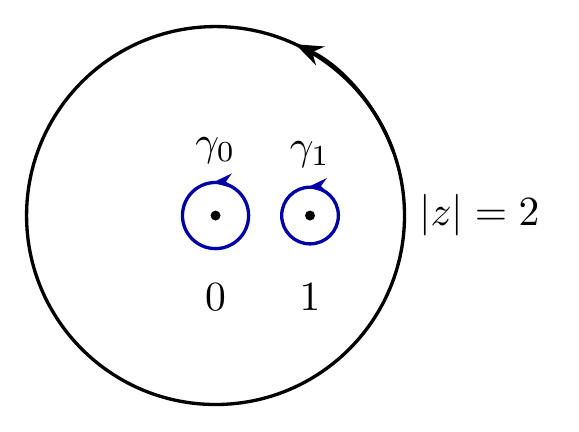
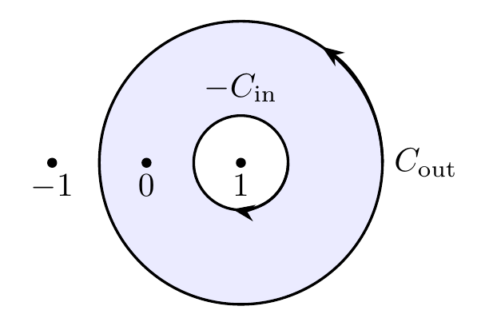

# Mathematics Method for Physics - Lecture 8 Exercises

**Complex Series: Preliminaries: Exercises**

Instructor: Zhaolong Han, SOCE, Shanghai Jiao Tong University

Email: han.arkey@sjtu.edu.cn

The contour-integral practice and a worked Taylor expansion from the 25 October notes are collected here. Each contour is counterclockwise unless another orientation is specified. Assigned exercises and calculation checks follow the worked examples.

## 1. Contour-Integral Exercises

### 1.1 Removing an absolute value on a circle

Evaluate

$$
I=\oint_{|z|=2}\frac{e^z}{|z-1|^2}\,\mathrm{d} z.
\tag{1}
$$

One approach is to set $z=2e^{\mathrm{i}t}$, $0\leq t\leq2\pi$. A shorter approach uses
$z\bar z=4$ on this particular circle:

$$
|z-1|^2=(z-1)(\bar z-1)
 =(z-1)\left(\frac4z-1\right)
 =-\frac{(z-1)(z-4)}z.
\tag{2}
$$

Consequently,

$$
I=-\oint_{|z|=2}\frac{z e^z/(z-4)}{z-1}\,\mathrm{d} z
   =-2\pi \mathrm{i}\,\frac{e}{1-4}
   =\boxed{\frac{2\pi \mathrm{i} e}{3}}.
\tag{3}
$$

The numerator $ze^z/(z-4)$ is holomorphic on and inside this circle, so Cauchy's integral formula applies. The replacement $\bar z=4/z$ is an identity on the contour; it is not an identity throughout the plane.

### 1.2 The distinction between $\,\mathrm{d} z$ and $|\,\mathrm{d} z|$

Consider the two different integrals

$$
I_1=\oint_{|z|=2}\frac{\,\mathrm{d} z}{|z-1|^2},
 \qquad
 I_2=\oint_{|z|=2}\frac{|\,\mathrm{d} z|}{|z-1|^2}.
\tag{4}
$$

The first is a complex contour integral. The same reduction gives

$$
I_1=-\oint_{|z|=2}\frac{z/(z-4)}{z-1}\,\mathrm{d} z
     =\boxed{\frac{2\pi \mathrm{i}}{3}}.
\tag{5}
$$

The second is an integral with respect to arc length, a positive real quantity. Since $|\,\mathrm{d} z|=2\,\mathrm{d} t$,

$$
I_2=2\int_0^{2\pi}\frac{\,\mathrm{d} t}{5-4\cos t}.
\tag{6}
$$

Set $\zeta=e^{\mathrm{i}t}$, so $\,\mathrm{d} t=\,\mathrm{d}\zeta/(\mathrm{i}\zeta)$. Then

$$
\begin{aligned}
 I_2&=\frac{2}{\mathrm{i}}\oint_{|\zeta|=1}
             \frac{\,\mathrm{d}\zeta}{5\zeta-2\zeta^2-2}\\
    &=-\frac{1}{\mathrm{i}}\oint_{|\zeta|=1}
             \frac{\,\mathrm{d}\zeta}{(\zeta-\tfrac12)(\zeta-2)}
      =\boxed{\frac{4\pi}{3}}.
\end{aligned}
\tag{7}
$$

Reversing the contour reverses $I_1$ but leaves the arc-length integral
$I_2$ unchanged.

### 1.3 Even cosine moments

For an integer $n\geq0$, introduce

$$
J_n=\oint_{|z|=1}\left(z+\frac1z\right)^{2n}\frac{\,\mathrm{d} z}{z}.
\tag{8}
$$

For every integer $m$,

$$
\oint_{|z|=1}z^m\,\mathrm{d} z=
 \begin{cases}2\pi \mathrm{i},&m=-1,\\0,&m\neq-1.\end{cases}
\tag{9}
$$

In the binomial expansion of $J_n$, the exponent is $2n-2k-1$. Only $k=n$ contributes, and hence

$$
J_n=2\pi \mathrm{i}\binom{2n}{n}.
\tag{10}
$$

On the other hand, $z=e^{\mathrm{i}t}$ gives $z+z^{-1}=2\cos t$ and
$\,\mathrm{d} z/z=\mathrm{i}\,\mathrm{d} t$. Therefore

$$
\boxed{\int_0^{2\pi}\cos^{2n}t\,\mathrm{d} t
   =\frac{2\pi}{2^{2n}}\binom{2n}{n}
   =\frac{2\pi(2n)!}{2^{2n}(n!)^2}.}
\tag{11}
$$

### 1.4 Checking all singularities before using Cauchy's formula

For the small circle centered at $1$, the function $e^{1/z}$ is holomorphic throughout the enclosed disk, so

$$
\oint_{|z-1|=1/2}\frac{e^{1/z}}{z-1}\,\mathrm{d} z=2\pi \mathrm{i} e.
\tag{12}
$$

For the larger circle $|z|=2$, the same argument fails: both $0$ and $1$ are singularities of the integrand. Deform the contour into two disjoint small counterclockwise circles $\gamma_0$ and $\gamma_1$, surrounding $0$ and $1$, respectively:

$$
\oint_{|z|=2}\frac{e^{1/z}}{z-1}\,\mathrm{d} z
 =\oint_{\gamma_0}\frac{e^{1/z}}{z-1}\,\mathrm{d} z
  +\oint_{\gamma_1}\frac{e^{1/z}}{z-1}\,\mathrm{d} z.
\tag{13}
$$

*Deforming the large circle into two positive circles about the singularities.*

The integral on $\gamma_1$ is $2\pi \mathrm{i} e$. To evaluate the one on $\gamma_0$, choose $|z|=\rho<1$ and use

$$
e^{1/z}=\sum_{m=0}^{\infty}\frac{z^{-m}}{m!},
 \qquad
 \frac1{z-1}=-\sum_{k=0}^{\infty}z^k.
\tag{14}
$$

Both series converge absolutely and uniformly on this fixed circle. Their product may therefore be integrated term by term. The coefficient of
$z^{-1}$ is

$$
-\sum_{k=0}^{\infty}\frac1{(k+1)!}=1-e.
\tag{15}
$$

The contour moments above now give

$$
\oint_{\gamma_0}\frac{e^{1/z}}{z-1}\,\mathrm{d} z=2\pi \mathrm{i}(1-e),
 \qquad
 \boxed{\oint_{|z|=2}\frac{e^{1/z}}{z-1}\,\mathrm{d} z=2\pi \mathrm{i}.}
\tag{16}
$$

These series calculations anticipate the power-series and Laurent-series methods discussed in Lectures 8 and 9.

### 1.5 A contour with an inner boundary

Let $C_{\mathrm{out}}$ and $C_{\mathrm{in}}$ be counterclockwise circles
$|z-1|=3/2$ and $|z-1|=1/2$. The positive boundary of the intervening
annulus is

$$
C=C_{\mathrm{out}}-C_{\mathrm{in}}.
\tag{17}
$$

Thus the inner boundary is traversed clockwise. For this orientation, consider

$$
K=\oint_C\frac{e^{1/z}}{z^2-1}\,\mathrm{d} z.
\tag{18}
$$

*Positive boundary of the annulus: the outer circle is counterclockwise and the inner circle is clockwise.*

Only $0$ lies in the annulus: $1$ is in the hole and $-1$ is outside the outer circle. Deformation reduces $K$ to a small positive circle about $0$. On $0<|z|<1$,

$$
\frac{e^{1/z}}{z^2-1}
 =-\left(\sum_{m=0}^{\infty}\frac{z^{-m}}{m!}\right)
      \left(\sum_{k=0}^{\infty}z^{2k}\right).
\tag{19}
$$

The coefficient of $z^{-1}$ is
$-\sum_{k=0}^{\infty}1/(2k+1)!=-\sinh1$, so

$$
\boxed{K=-2\pi \mathrm{i}\sinh1.}
\tag{20}
$$

Reversing this whole boundary changes the sign. If instead both circles are traversed counterclockwise, the contour is $C_{\mathrm{out}}+
C_{\mathrm{in}}$, and its integral is $2\pi \mathrm{i}\cosh1$.

## 2. Taylor Expansion: Example 4.15

Consider $f(z)=1/z^3$ and expand about $z_0=1$.

The nearest singularity is $z=0$, at distance $1$. Direct differentiation gives

$$
f^{(n)}(1)=\frac{(-1)^n(n+2)!}{2},
 \qquad
 \boxed{\frac1{z^3}=\sum_{n=0}^{\infty}
       (-1)^n\frac{(n+1)(n+2)}2(z-1)^n,\quad |z-1|<1.}
\tag{21}
$$

An indirect method begins with

$$
\frac1z=\frac1{1+(z-1)}
       =\sum_{n=0}^{\infty}(-1)^n(z-1)^n,\qquad |z-1|<1.
\tag{22}
$$

Since $(1/z)''=2/z^3$, differentiate twice and divide by $2$:

$$
\frac1{z^3}
 =\frac12\sum_{n=2}^{\infty}(-1)^n n(n-1)(z-1)^{n-2}
 =1-3(z-1)+6(z-1)^2-10(z-1)^3+\cdots .
\tag{23}
$$

## 3. Assigned Exercises

Textbook p. 83: B8--B10; p. 116: A1, A2, A4 and B1--B2. Use the assigned subitems for A1 and A2.

## 4. Checks on the Calculations

The factorization

$$
5\zeta-2\zeta^2-2=-2(\zeta-\tfrac12)(\zeta-2)
\tag{24}
$$

changes the prefactor $2/\mathrm{i}$ to $-1/\mathrm{i}$. This gives
$4\pi/3$ for the arc-length integral.

For an annular region, the positive inner boundary is clockwise. The value $-2\pi\mathrm{i}\sinh1$ uses that boundary orientation. It changes sign if the whole boundary is reversed.

The identity $(1/z)''=2/z^3$ has a positive sign. It gives the coefficients
$1,-3,6,-10,\ldots$ in the Taylor expansion of $1/z^3$ about $1$.
