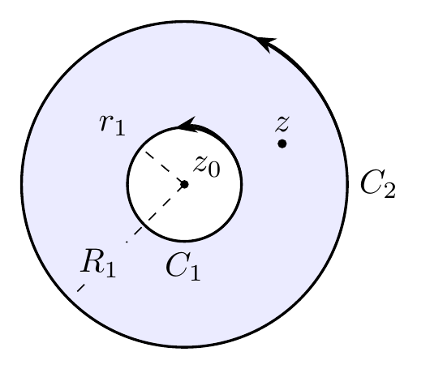
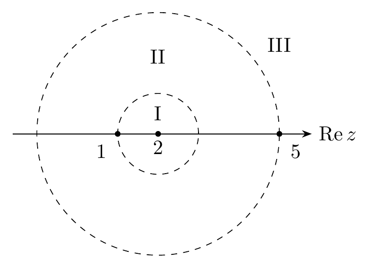
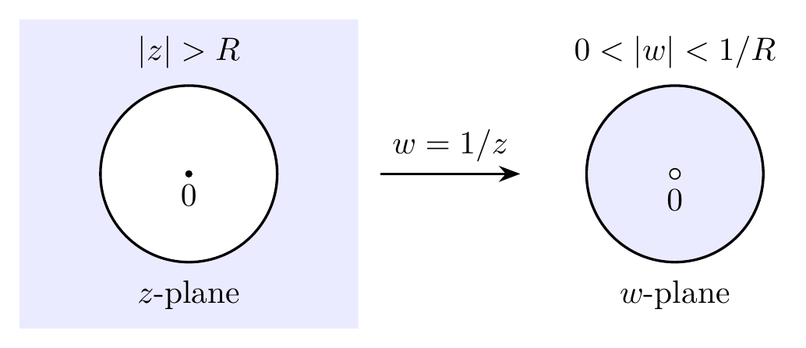

# Mathematics Method for Physics - Lecture 9

**Laurent Series and Singularities**

Instructor: Zhaolong Han, SOCE, Shanghai Jiao Tong University

Email: han.arkey@sjtu.edu.cn

Taylor series describe holomorphic functions on disks. When the center is excluded, negative powers become necessary and the natural region is an annulus. Laurent's theorem gives the expansion and its unique coefficients. The principal part then distinguishes removable singularities, poles and essential singularities. Finally, the local coordinate $w=1/z$ brings the point at infinity into the same picture.

## 1. Recap: Taylor Expansions and Their Domains

If $f$ is holomorphic near $z_0$, then

$$
f(z)=\sum_{n=0}^{\infty}\frac{f^{(n)}(z_0)}{n!}(z-z_0)^n,
 \qquad
 \frac{f^{(n)}(z_0)}{n!}
  =\frac1{2\pi \mathrm{i}}\oint_C
             \frac{f(\zeta)}{(\zeta-z_0)^{n+1}}\,\mathrm{d}\zeta.
\tag{1}
$$

Here $C$ is a small counterclockwise circle inside the region of holomorphy. The expansion is unique.

**Remark.** The series represents $f$ throughout any disk centered at $z_0$ in which
$f$ is holomorphic. For the rational examples below, its exact radius is
the distance to the nearest pole. In general, the radius is limited by a singularity of the holomorphic continuation, not by an arbitrarily chosen boundary of the original domain.

## 2. From Disks to Annuli

A Taylor series contains only nonnegative powers.

**Definition 1 (Laurent series).**

An annulus

$$
A\coloneqq\{z:r<|z-z_0|<R\}
\tag{2}
$$

need not contain its center, so negative powers are natural:

$$
\sum_{n=-\infty}^{\infty}c_n(z-z_0)^n
 =\underbrace{\sum_{n=1}^{\infty}\frac{c_{-n}}{(z-z_0)^n}}
              _{\text{principal part}}
  +\underbrace{\sum_{n=0}^{\infty}c_n(z-z_0)^n}
              _{\text{regular part}}.
\tag{3}
$$

This means that the two one-sided series converge separately.

The regular part converges inside some disk $|z-z_0|<R$. For the principal part, set $w\coloneqq1/(z-z_0)$:

$$
\sum_{n=1}^{\infty}\frac{c_{-n}}{(z-z_0)^n}
 =\sum_{n=1}^{\infty}c_{-n}w^n.
\tag{4}
$$

If this series has radius $\rho$, it converges for
$|z-z_0|>1/\rho$. The common region is therefore an annulus
$r<|z-z_0|<R$, with $r=1/\rho$. It is nonempty only when $r<R$.
The limiting cases $r=0$ and $R=\infty$ are allowed. The sum is holomorphic in that annulus.

## 3. Laurent's Theorem

**Theorem 1 (Laurent's theorem).**

Let $0\leq r<R\leq\infty$. If $f$ is holomorphic in $r<|z-z_0|<R$, then

$$
\boxed{f(z)=\sum_{n=-\infty}^{\infty}c_n(z-z_0)^n}
\tag{5}
$$

throughout that annulus, and this expansion is unique. Its coefficients are

$$
\boxed{c_n\coloneqq \frac1{2\pi \mathrm{i}}\oint_{|\zeta-z_0|=\rho}
             \frac{f(\zeta)}{(\zeta-z_0)^{n+1}}\,\mathrm{d}\zeta,
       \qquad n\in\mathbb Z,\quad r<\rho<R.}
\tag{6}
$$

**Remark.** The circle is counterclockwise. The coefficients do not depend on the choice of $\rho$ within the same annulus. The series converges absolutely and uniformly on compact subannuli.

### 3.1 Proof: the outer and inner boundary contributions

Fix $z$ and choose radii $r<r_1<|z-z_0|<R_1<R$. Denote the counterclockwise circles of radii $r_1,R_1$ by $C_1,C_2$. The positive boundary of the smaller annulus is $C_2-C_1$. Cauchy's formula for this region gives

$$
f(z)=\frac1{2\pi \mathrm{i}}\oint_{C_2}\frac{f(\zeta)}{\zeta-z}\,\mathrm{d}\zeta
      -\frac1{2\pi \mathrm{i}}\oint_{C_1}\frac{f(\zeta)}{\zeta-z}\,\mathrm{d}\zeta.
\tag{7}
$$

*The two circles used in the proof of Laurent's theorem; both are drawn counterclockwise.*

Both drawn circles are counterclockwise; the minus sign supplies the inner boundary orientation.

On $C_2$ the ratio $|(z-z_0)/(\zeta-z_0)|<1$, so

$$
\frac1{\zeta-z}
  =\sum_{n=0}^{\infty}\frac{(z-z_0)^n}{(\zeta-z_0)^{n+1}}.
\tag{8}
$$

This produces the regular part with

$$
c_n=\frac1{2\pi \mathrm{i}}\oint_{C_2}
             \frac{f(\zeta)}{(\zeta-z_0)^{n+1}}\,\mathrm{d}\zeta,\quad n\geq0.
\tag{9}
$$

On $C_1$, the useful ratio is reversed:

$$
\frac1{\zeta-z}
   =-\frac1{z-z_0}\frac1{1-(\zeta-z_0)/(z-z_0)}
   =-\sum_{k=0}^{\infty}\frac{(\zeta-z_0)^k}{(z-z_0)^{k+1}}.
\tag{10}
$$

The leading minus sign cancels the inner-boundary minus sign, giving

$$
-\frac1{2\pi \mathrm{i}}\oint_{C_1}\frac{f(\zeta)}{\zeta-z}\,\mathrm{d}\zeta
   =\sum_{n=1}^{\infty}\frac{c_{-n}}{(z-z_0)^n},
 \quad
 c_{-n}=\frac1{2\pi \mathrm{i}}\oint_{C_1}
                  (\zeta-z_0)^{n-1}f(\zeta)\,\mathrm{d}\zeta.
\tag{11}
$$

Uniform convergence on the two circles justifies the integrations. Contour deformation within the original annulus puts both coefficient formulas on any intermediate circle. Conversely, integrating a Laurent series against $(z-z_0)^{-k-1}$ extracts $c_k$ by the contour-moment formula. This proves uniqueness.

## 4. Laurent Expansions: Examples

The following examples show how the principal part and the annulus change with the function and the choice of center. In each case, the convergence region is part of the answer.

### 4.1 Example 4.18: a puncture with no principal part

For $0<|z|<\infty$,

$$
\frac{\sin z}{z}
 =\sum_{n=0}^{\infty}\frac{(-1)^nz^{2n}}{(2n+1)!}
 =1-\frac{z^2}{3!}+\frac{z^4}{5!}-\cdots .
\tag{12}
$$

All negative-power coefficients vanish. Defining $f(0)=1$ extends this function holomorphically through the puncture.

### 4.2 Example 4.19: infinitely many negative powers

For $0<|z|<\infty$,

$$
e^z+e^{1/z}
 =\sum_{n=1}^{\infty}\frac{z^n}{n!}
      +2+\sum_{n=1}^{\infty}\frac1{n!z^n}.
\tag{13}
$$

There are infinitely many nonzero negative-power coefficients. The constant term is $2$, since each exponential contributes $1$.

### 4.3 Example 4.20: a finite principal part

Expand $f(z)=1/[z^2(z-1)]$ about $z_0=1$. Put $w\coloneqq z-1$:

$$
f(z)=\frac1w\frac1{(1+w)^2}
 =\boxed{\sum_{n=0}^{\infty}(-1)^n(n+1)w^{n-1}},
 \qquad 0<|w|<1.
\tag{14}
$$

In particular,

$$
f(z)=\frac1{z-1}-2+3(z-1)-4(z-1)^2+\cdots .
\tag{15}
$$

The principal part consists of the single term $1/(z-1)$.

For the same function centered at $0$, in the assigned region
$1<|z|<2$, use

$$
f(z)=\frac1{z^3}\frac1{1-1/z}
     =\sum_{n=0}^{\infty}\frac1{z^{n+3}}.
\tag{16}
$$

In fact, this expansion is valid throughout $|z|>1$.

### 4.4 Example 4.21: three different regions

Let

$$
f(z)\coloneqq\frac4{z^2-6z+5}
     \equiv\frac1{z-5}-\frac1{z-1},
 \qquad w\coloneqq z-2.
\tag{17}
$$

The poles $1$ and $5$ are at distances $1$ and $3$ from the center $2$, so the three maximal circular regions are

$$
|w|<1,\qquad 1<|w|<3,\qquad |w|>3.
\tag{18}
$$

*The poles at 1 and 5 determine three circular regions about the center 2.*

Since $f(z)=1/(w-3)-1/(w+1)$, choose a geometric series separately for each denominator:

$$
\begin{aligned}
 \text{I:}\quad f(z)
   &=-\sum_{n=0}^{\infty}
        \left(\frac1{3^{n+1}}+(-1)^n\right)w^n,
       &&|w|<1,\\
 \text{II:}\quad f(z)
   &=-\sum_{n=0}^{\infty}\frac{w^n}{3^{n+1}}
     -\sum_{n=0}^{\infty}(-1)^n w^{-n-1},
       &&1<|w|<3,\\
 \text{III:}\quad f(z)
   &=\sum_{n=0}^{\infty}\bigl(3^n-(-1)^n\bigr)w^{-n-1},
       &&|w|>3.
\end{aligned}
\tag{19}
$$

In region III the $w^{-1}$ coefficient is zero; the leading term is
$4w^{-2}$. The function is the same in all three regions, but its
Laurent coefficients depend on the annulus.

## 5. Isolated and Nonisolated Singularities

**Definition 2 (Isolated and nonisolated singularities).**

A point $z_0$ is an isolated singularity if $f$ is holomorphic on some punctured disk $0<|z-z_0|<r$, while not initially holomorphic at $z_0$. For a single-valued function, a singular point with no such punctured disk is nonisolated.

**Remark.** An accumulation of isolated poles is one way this can occur. A multivalued expression, such as a logarithm at a branch point, must first be given a branch and a domain; it is not covered by the isolated-singularity classification.

For

$$
f(z)\coloneqq\frac1{(z^2+1)(z^2+4)},
\tag{20}
$$

the four poles $\pm \mathrm{i},\pm2\mathrm{i}$ are isolated. Around $\mathrm{i}$, for example,
$0<|z-\mathrm{i}|<1$ contains no other singularity.

For

$$
g(z)\coloneqq\frac1{\sin(1/z)},
\tag{21}
$$

the points

$$
z_k\coloneqq \frac1{k\pi},\qquad k\in\mathbb Z\setminus\{0\},
\tag{22}
$$

are isolated simple poles. They accumulate at $0$. Every punctured disk about $0$ contains such poles, so $0$ is nonisolated. A Laurent expansion on an entire punctured disk about $0$ is therefore unavailable.

## 6. Classification by the Principal Part

**Definition 3 (Classification of isolated singularities).**

For an isolated singularity, write the Laurent expansion in
$0<|z-z_0|<r$. There are exactly three possibilities.

| Type | Principal part |
| --- | --- |
| Removable | All negative-power coefficients are zero. |
| Pole of order $m$ | Finitely many nonzero negative-power coefficients, with $c_{-m}\neq0$ and $c_{-n}=0$ for $n>m$. |
| Essential | Infinitely many nonzero negative-power coefficients. |

Thus $\sin z/z$ has a removable singularity at $0$, whereas $e^{1/z}$ has an essential singularity there.

### 6.1 A rational example

For

$$
h(z)\coloneqq\frac1{z^2(z^2+1)},
\tag{23}
$$

the origin is a double pole, since

$$
h(z)=\frac1{z^2}\sum_{n=0}^{\infty}(-1)^nz^{2n}
      =\frac1{z^2}-1+z^2-z^4+\cdots,\quad0<|z|<1.
\tag{24}
$$

The points $\pm \mathrm{i}$ are simple poles. Near $\mathrm{i}$, write

$$
h(z)=\frac{q(z)}{z-\mathrm{i}},
 \qquad q(z)\coloneqq\frac1{z^2(z+\mathrm{i})},\qquad q(\mathrm{i})=-\frac1{2\mathrm{i}}\neq0.
\tag{25}
$$

Taylor expansion of $q$ supplies the Laurent expansion of $h$; its principal part is $-\frac1{2\mathrm{i}}(z-\mathrm{i})^{-1}$. Near $-\mathrm{i}$ the principal part is $\frac1{2\mathrm{i}}(z+\mathrm{i})^{-1}$.

### 6.2 Poles and zeros of the reciprocal

**Proposition 1 (Poles and reciprocal zeros).**

The point $z_0$ is a pole of $f$ of order $m$ if and only if

$$
f(z)=\frac{q(z)}{(z-z_0)^m},
 \qquad q\ \hbox{holomorphic near }z_0,\quad q(z_0)\neq0.
\tag{26}
$$

Equivalently, $1/f=(z-z_0)^m/q(z)$, extended by $0$ at $z_0$, has a zero of order $m$: the factor $1/q$ is holomorphic and nonzero there. Conversely, factor a zero of $1/f$ in this way and take the reciprocal.

### 6.3 Cancellation at the origin

For

$$
f(z)\coloneqq\frac z{e^z-1},
\tag{27}
$$

the equation $e^z=1$ gives $z_k\coloneqq 2k\pi \mathrm{i}$. At $0$ the numerator and denominator both vanish to first order:

$$
\frac z{e^z-1}=\frac1{1+z/2!+z^2/3!+\cdots}\longrightarrow1.
\tag{28}
$$

Thus $0$ is removable, with extension $f(0)=1$. At every
$2k\pi \mathrm{i}$ with $k\neq0$, the denominator has a simple zero and the
numerator is nonzero, so the point is a simple pole.

## 7. Limit Tests for Isolated Singularities

**Proposition 2 (Limit tests).**

The following tests require an *isolated* singularity at $z_0$:

| Behavior as $z\to z_0$ | Type |
| --- | --- |
| A finite limit $L$ exists | Removable; set $f(z_0)=L$. |
| $\lvert f(z)\rvert\to\infty$ | Pole. |
| Neither a finite limit nor a limit $\infty$ exists | Essential. |

### 7.1 Why the limit tests work

If $f$ is bounded by $M$ on a punctured disk, the Laurent coefficient formula on a circle of radius $\rho$ gives, for every $n\geq1$,

$$
|c_{-n}|\leq M\rho^n.
\tag{29}
$$

Letting $\rho\to0$ shows that every negative-power coefficient vanishes. Thus boundedness, and in particular a finite limit, gives a removable singularity. Conversely, the holomorphic extension has that finite limit.

If $|f(z)|\to\infty$, then $f$ has no zeros sufficiently close to $z_0$. The reciprocal $1/f$ tends to zero and extends holomorphically across
$z_0$. It is not identically zero, so its zero has a finite order $m$.
Taking the reciprocal gives a pole of order $m$. The converse follows from $f(z)=q(z)/(z-z_0)^m$ with $q(z_0)\neq0$. The essential case is the remaining possibility in the Laurent classification.

## 8. Singularities at Infinity

**Definition (extended complex plane).** The extended complex plane is $\widehat{\mathbb{C}}\coloneqq \mathbb{C}\cup\{\infty\}$. A neighborhood of infinity has the form
$\{|z|>R\}\cup\{\infty\}$. To study $f$ there, set

$$
w\coloneqq\frac1z,\qquad F(w)\coloneqq f(1/w).
\tag{30}
$$

Then $|z|>R$ corresponds to $0<|w|<1/R$.

*The coordinate $w=1/z$ maps an exterior region to a punctured disk.*

**Definition 4 (Singularity at infinity).**

If $f$ is holomorphic for all sufficiently large finite $z$, infinity is an isolated point to be classified by the singularity of $F$ at $0$. In particular:

-  infinity is removable when $F$ extends holomorphically to $0$;

-  infinity is a pole of order $m$ when $F$ has a pole of order $m$ at $0$;

-  infinity is essential when $F$ has an essential singularity at $0$.

**Remark.** The same limit tests apply as $z\to\infty$, after checking that the singularity there is isolated.

If finite singularities $z_k$ tend to infinity, there is no exterior region free of singularities; infinity is nonisolated.

### 8.1 Examples and a nonisolated finite point

-  For $e^{1/(1-z)}$, the transformed function is
$F(w)=\exp[w/(w-1)]$. It is holomorphic at $0$ with value $1$,
so infinity is removable with value $1$.

-  For fixed $a,b\in\mathbb{C}$, the function $1/[(z-a)(z-b)]$ becomes
$F(w)=w^2/[(1-aw)(1-bw)]$. Its extension has a zero of order
$2$ at $0$, so infinity is removable with value $0$.

-  For $1/(e^z-1)$, all $2k\pi \mathrm{i}$, $k\in\mathbb Z$, are simple
poles. They are unbounded, so infinity is nonisolated.

-  The poles of $1/\sin(1/z)$ at $1/(k\pi)$ accumulate at $0$.
Thus $0$ is nonisolated.

-  For $\tan[1/(z-1)]$, poles occur at

$$
z_k\coloneqq 1+\frac1{k\pi+\pi/2},\qquad k\in\mathbb Z.
\tag{31}
$$

Since $z_k\to1$ as $|k|\to\infty$, $1$ is nonisolated. There is no Laurent expansion valid on a full punctured disk
$0<|z-1|<r$.

### 8.2 Reading the exterior Laurent series

If infinity is isolated, write, for sufficiently large $|z|$,

$$
f(z)=\sum_{n=1}^{\infty}c_{-n}z^{-n}
              +c_0+\sum_{n=1}^{\infty}c_nz^n.
\tag{32}
$$

The positive powers of $z$ become the principal part of $F(w)$ at $0$. Therefore infinity is removable if all $c_n$ with $n\geq1$ vanish, a pole of order $m$ if the highest nonzero positive power is $z^m$, and essential if infinitely many positive-power coefficients are nonzero. For example, $e^{1/z}$ is removable at infinity, whereas $e^z$ is essential there.
