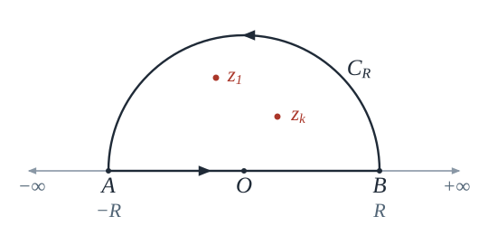
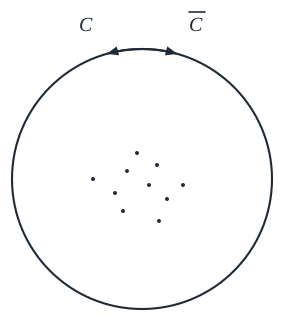
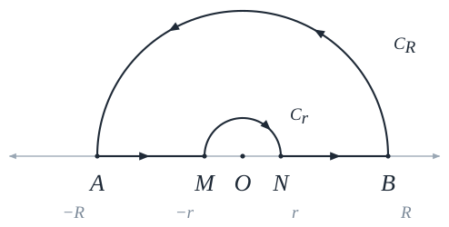
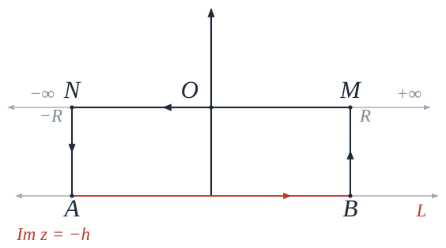
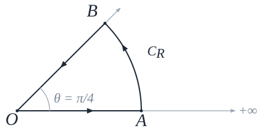
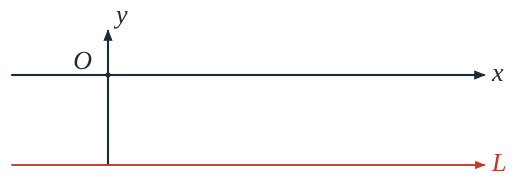

# 第12讲　留数定理的应用与傅里叶变换

Lecture 12. Applications of the Residue Theorem and the Fourier Transform

## 11月8日作业与11月15日复习答疑

November 8 homework and November 15 review

**11月8日作业**　教材第143页，第1题双数小题、第2题 (6)、(7)、第3题。B套第1、2、3题。  
**November 8 homework.** Textbook p. 143, even-numbered parts of Problem 1, parts (6) and (7) of Problem 2, and Problem 3. Set B, Problems 1, 2, and 3.

若 $\large f$ 在无穷远点的去心邻域内解析，且 $\large \lim_{z\to\infty}f(z)=A$ 有限，则 $\large z=\infty$ 为可去奇点。令 $\large w=1/z$，则 $\large f(1/w)$ 在 $\large w=0$ 的极限为 $\large A$。  
If $\large f$ is analytic in a punctured neighborhood of infinity and $\large \lim_{z\to\infty}f(z)=A$ is finite, then infinity is a removable singularity. With $\large w=1/z$, the limit of $\large f(1/w)$ at $\large w=0$ is $\large A$.

### 11月15日（周三）复习答疑：教材第144页，B套第2题

Wednesday, November 15 review: textbook p. 144, Set B, Problem 2

设 $\large z_0$ 为 $\large f$ 的 $\large m$ 阶极点。对任意正整数 $\large n$，证明  
Let $\large z_0$ be a pole of $\large f$ of order $\large m$. For every positive integer $\large n$, prove

$$
\Large
\operatorname{Res}(f,z_0)
=\frac{1}{(m+n-1)!}\lim_{z\to z_0}
 \big[(z-z_0)^{m+n}f(z)\big]^{(m+n-1)}. \tag{1}
$$

通常的极点留数公式相当于取 $\large n=0$。  
Taking $\large n=0$ gives the usual formula for the residue at a pole.

$$
\Large
\operatorname{Res}(f,z_0)
=\frac{1}{(m-1)!}\lim_{z\to z_0}
 \big[(z-z_0)^m f(z)\big]^{(m-1)}. \tag{2}
$$

**证明。** 在 $\large z_0$ 附近作洛朗展开，乘以 $\large (z-z_0)^{m+n}$。  
**Proof.** Expand in a Laurent series near $\large z_0$ and multiply by $\large (z-z_0)^{m+n}$.

$$
\Large
\begin{aligned}
f(z)&=\frac{c_{-m}}{(z-z_0)^m}+\cdots
 +\frac{c_{-1}}{z-z_0}+c_0+\cdots,\\
(z-z_0)^{m+n}f(z)
 &=c_{-m}(z-z_0)^n+\cdots+c_{-1}(z-z_0)^{m+n-1}\\
 &\quad+O\big((z-z_0)^{m+n}\big).
\end{aligned}
$$

逐项求 $\large m+n-1$ 阶导数。次数较低的项消失，余下高次项的导数在 $\large z_0$ 处为零。  
Differentiate term by term $\large m+n-1$ times. Terms of lower degree disappear, and the differentiated terms of higher degree vanish at $\large z_0$.

$$
\Large
\lim_{z\to z_0}\big[(z-z_0)^{m+n}f(z)\big]^{(m+n-1)}
=(m+n-1)!\,c_{-1}.
$$

$\large c_{-1}=\operatorname{Res}(f,z_0)$，即得式 (1)。  
Since $\large c_{-1}=\operatorname{Res}(f,z_0)$, this gives (1).

### 例：含高阶极点的围道积分

Example — a contour integral with a high-order pole

$$
\Large
I=\oint_{|z|=1}\frac{z-\sin z}{z^{2023}}\,dz,
\qquad f(z)=\frac{z-\sin z}{z^{2023}}.
$$

由 $\large z-\sin z=z^3/3!+O(z^5)$，圆内唯一的极点 $\large z=0$ 为 $\large 2020$ 阶，故 $\large I=2\pi i\operatorname{Res}(f,0)$。  
Since $\large z-\sin z=z^3/3!+O(z^5)$, the only pole inside the circle is at $\large z=0$ and has order $\large 2020$. Hence $\large I=2\pi i\operatorname{Res}(f,0)$.

**方法一。** 公式 (2) 给出  
**Method 1.** Formula (2) gives

$$
\Large
\operatorname{Res}(f,0)=\frac1{2019!}\lim_{z\to0}
\left(\frac{z-\sin z}{z^3}\right)^{(2019)}=0.
$$

$\large (z-\sin z)/z^3$ 在零点可去且为偶函数，因此其奇数阶导数在零点为零。  
The quotient $\large (z-\sin z)/z^3$ has a removable singularity at zero and is even, so its odd-order derivatives vanish there.

**方法二。** 在公式 (1) 中取 $\large n=3$。由 $\large (\sin z)^{(k)}=\sin(z+k\pi/2)$，  
**Method 2.** Take $\large n=3$ in (1). Using $\large (\sin z)^{(k)}=\sin(z+k\pi/2)$ gives

$$
\Large
\begin{aligned}
\operatorname{Res}(f,0)
&=\frac1{2022!}\lim_{z\to0}[z-\sin z]^{(2022)}\\
&=-\frac1{2022!}\sin\left(\frac{2022\pi}{2}\right)=0.
\end{aligned}
$$

**方法三。** 在原点展开。分子只含奇次幂，除以 $\large z^{2023}$ 后只余偶次幂。  
**Method 3.** Expand about zero. The numerator contains only odd powers, so division by $\large z^{2023}$ leaves only even powers.

$$
\Large
f(z)=\frac{1}{3!\,z^{2020}}-\frac{1}{5!\,z^{2018}}+\cdots,
\qquad c_{-1}=0,\qquad I=0.
$$

## 无穷远点的留数

Residues at infinity

### 教材第123页，例5.2与例5.3

Textbook p. 123, Examples 5.2 and 5.3

若 $\large c_{-1}$ 为无穷远处洛朗展开中 $\large z^{-1}$ 的系数，则 $\large \operatorname{Res}(f,\infty)=-c_{-1}$。  
If $\large c_{-1}$ is the coefficient of $\large z^{-1}$ in the Laurent expansion at infinity, then $\large \operatorname{Res}(f,\infty)=-c_{-1}$.

**例5.2 (1)。** 在 $\large |z|>1$ 展开。  
**Example 5.2 (1).** Expand for $\large |z|>1$.

$$
\Large
\frac1{1-z}=-\frac1z\frac1{1-1/z}
=-\frac1z\left(1+\frac1z+\frac1{z^2}+\cdots\right),
\qquad \operatorname{Res}\!\left(\frac1{1-z},\infty\right)=1.
$$

**(2)。** $\large \sin z$ 和 $\large \cos z$ 的幂级数只含非负次幂。  
**(2).** The power series of $\large \sin z$ and $\large \cos z$ contain only nonnegative powers.

$$
\Large
\begin{gathered}
\sin z=z-\frac{z^3}{3!}+\cdots,\qquad
\cos z=1-\frac{z^2}{2!}+\cdots,\\
\operatorname{Res}(\sin z-\cos z,\infty)=0.
\end{gathered}
$$

**(3)。** 展开 $\large 1-\cos z$，其中 $\large n\ge1$。  
**(3).** Expand $\large 1-\cos z$ for $\large n\ge1$.

$$
\Large
\begin{aligned}
\frac{1-\cos z}{z^{2n+1}}
 &=\sum_{k=1}^{\infty}\frac{(-1)^{k+1}}{(2k)!}\,z^{2k-2n-1},\\
c_{-1}&=\frac{(-1)^{n+1}}{(2n)!},\qquad
\operatorname{Res}\!\left(\frac{1-\cos z}{z^{2n+1}},\infty\right)
=\frac{(-1)^n}{(2n)!}.
\end{aligned}
$$

**例5.3。** 若 $\large P_n$ 是 $\large n$ 次多项式，比较最高次项可得  
**Example 5.3.** If $\large P_n$ is a polynomial of degree $\large n$, comparing the leading terms gives

$$
\Large
\lim_{z\to\infty}z\frac{P_n'(z)}{P_n(z)}=n,\qquad
\operatorname{Res}\!\left(\frac{P_n'}{P_n},\infty\right)=-n.
$$

### 教材第132页，例5.12

Textbook p. 132, Example 5.12

$$
\Large
I=\oint_{|z|=4} f(z)\,dz,\qquad
f(z)=\frac{z^{15}}{(z^2+1)^2(z^4+2)^3}.
$$

六个有限极点的模为 $\large 1$ 或 $\large 2^{1/4}$，均在正向圆周 $\large |z|=4$ 内。故  
The six finite poles have modulus $\large 1$ or $\large 2^{1/4}$, so they are all inside the counterclockwise circle $\large |z|=4$. Thus

$$
\Large
I=2\pi i\sum_{k=1}^6\operatorname{Res}(f,z_k)
=-2\pi i\operatorname{Res}(f,\infty).
$$

**方法一。** 令 $\large w=1/z$，则 $\large dz=-w^{-2}\,dw$。  
**Method 1.** Set $\large w=1/z$, so $\large dz=-w^{-2}\,dw$.

$$
\Large
\begin{aligned}
\operatorname{Res}(f,\infty)
 &=-\operatorname{Res}\!\left(\frac{f(1/w)}{w^2},0\right)\\
 &=-\operatorname{Res}\!\left(
 \frac{1}{w(1+w^2)^2(1+2w^4)^3},0\right)=-1.
\end{aligned}
$$

**方法二。** 若 $\large zf(z)$ 在无穷远处有有限极限，极限即为 $\large z^{-1}$ 的系数。  
**Method 2.** If $\large zf(z)$ has a finite limit at infinity, that limit is the coefficient of $\large z^{-1}$.

$$
\Large
\lim_{z\to\infty}zf(z)
=\lim_{z\to\infty}\frac{z^{16}}{(z^2+1)^2(z^4+2)^3}=1,
\qquad \operatorname{Res}(f,\infty)=-1.
$$

$$
\Large
I=-2\pi i(-1)=2\pi i.
$$

## 教材第133页 §5.2　留数在实积分中的应用

Textbook p. 133, §5.2. Application of residues to real integrals

### （I）三角函数的有理式积分

(I) Integrals of rational functions of sine and cosine

令 $\large z=e^{ix}$。当 $\large x$ 从 $\large 0$ 到 $\large 2\pi$，$\large z$ 沿单位圆正向走一周。由欧拉公式，  
Set $\large z=e^{ix}$. As $\large x$ increases from $\large 0$ to $\large 2\pi$, $\large z$ makes one counterclockwise turn around the unit circle. Euler’s formula gives

$$
\Large
\sin x=\frac{z^2-1}{2iz},\qquad
\cos x=\frac{z^2+1}{2z},\qquad dx=\frac{dz}{iz}.
$$

因此，若积分路径上无奇点，则  
Provided the integrand has no singularities on the path,

$$
\Large
\int_0^{2\pi}\mathcal R(\sin x,\cos x)\,dx
=\oint_{|z|=1}
\mathcal R\!\left(\frac{z^2-1}{2iz},\frac{z^2+1}{2z}\right)
\frac{dz}{iz}.
$$

#### 例5.13

Example 5.13

$$
\Large
I=\int_0^{2\pi}\frac{\sin^2 x}{5+3\cos x}\,dx.
$$

也可用原函数写成 $\large F(2\pi)-F(0)$。用留数法，令 $\large z=e^{ix}$。  
An antiderivative gives $\large F(2\pi)-F(0)$. For the residue calculation, set $\large z=e^{ix}$.

$$
\Large
\begin{aligned}
I&=\oint_{|z|=1}
 \frac{\big((z^2-1)/(2iz)\big)^2}{5+3(z^2+1)/(2z)}\,\frac{dz}{iz}\\
 &=\frac{i}{2}\oint_{|z|=1}
 \frac{(z^2-1)^2}{z^2(3z^2+10z+3)}\,dz\\
 &=\frac{i}{6}\oint_{|z|=1}
 \frac{(z^2-1)^2}{z^2(z+\tfrac13)(z+3)}\,dz.
\end{aligned}
$$

记最后一个积分中的有理式为 $\large g(z)$。单位圆内有二阶极点 $\large z=0$ 和简单极点 $\large z=-1/3$。  
Write $\large g(z)$ for the rational function in the last integral. Inside the unit circle it has a double pole at $\large z=0$ and a simple pole at $\large z=-1/3$.

$$
\Large
\begin{aligned}
\operatorname{Res}(g,0)
 &=\left.\frac{d}{dz}
 \frac{(z^2-1)^2}{(z+\tfrac13)(z+3)}\right|_{z=0}
 =-\frac{10}{3},\\
\operatorname{Res}(g,-\tfrac13)
 &=\left.\frac{(z^2-1)^2}{z^2(z+3)}\right|_{z=-1/3}
 =\frac{(1/9-1)^2}{(1/9)(8/3)}=\frac83,\\
I&=\frac{i}{6}\,(2\pi i)
 \left(-\frac{10}{3}+\frac83\right)=\frac{2\pi}{9}.
\end{aligned}
$$

### （II）实轴上的有理函数积分

(II) Integrals of rational functions over the real axis

设 $\large P,Q$ 为多项式，约去公因子后 $\large Q$ 在实轴上无零点，且 $\large \deg Q\ge\deg P+2$。则  
Let $\large P,Q$ be polynomials. After common factors are cancelled, suppose $\large Q$ has no real zeros and $\large \deg Q\ge\deg P+2$. Then

$$
\Large
\int_{-\infty}^{\infty}\frac{P(x)}{Q(x)}\,dx
=2\pi i\sum_{\operatorname{Im}z_k>0}
 \operatorname{Res}\!\left(\frac{P}{Q},z_k\right).
$$

设 $\large z_k$ 为上半平面的极点。若 $\large Q$ 的系数为实数，非实零点成共轭对。  
Here $\large z_k$ are the poles in the upper half-plane. If $\large Q$ has real coefficients, its nonreal zeros occur in conjugate pairs.

**证明。** 取实轴上的有向线段 $\large \overline{AB}$，其中 $\large A=-R$、$\large B=R$。用从 $\large B$ 到 $\large A$ 的上半圆 $\large C_R$ 闭合。  
**Proof.** Take the directed real segment $\large \overline{AB}$ from $\large A=-R$ to $\large B=R$. Close it with the upper semicircle $\large C_R$ from $\large B$ to $\large A$.

$$
\Large
C=\overline{AB}+C_R.
$$

取 $\large R$ 足够大，使所有上半平面的极点都在 $\large C$ 内。由留数定理，  
Take $\large R$ large enough to enclose all the upper-half-plane poles. The residue theorem gives

$$
\Large
\begin{aligned}
2\pi i\sum_{\operatorname{Im}z_k>0}\operatorname{Res}
 \!\left(\frac{P}{Q},z_k\right)
 &=\oint_C\frac{P(z)}{Q(z)}\,dz\\
 &=\int_{-R}^{R}\frac{P(x)}{Q(x)}\,dx
  +\int_{C_R}\frac{P(z)}{Q(z)}\,dz.
\end{aligned}
$$

由于 $\large zP(z)/Q(z)\to0$，引理5.1给出圆弧积分趋于零。令 $\large R\to\infty$ 即得结论。  
Since $\large zP(z)/Q(z)\to0$, the arc integral tends to zero by Lemma 5.1. Letting $\large R\to\infty$ proves the formula.

#### 引理5.1

Lemma 5.1

设 $\large f$ 在圆弧上连续。若 $\large zf(z)\to0$，则 $\large \displaystyle\lim_{R\to\infty}\int_{C_R} f(z)\,dz=0$。取 $\large z=Re^{i\theta}$，$\large 0\le\theta\le\pi$。对任意 $\large \varepsilon>0$，$\large R$ 充分大时，圆弧上 $\large |zf(z)|<\varepsilon$。  
Suppose $\large f$ is continuous on the arcs. If $\large zf(z)\to0$, then $\large \displaystyle\lim_{R\to\infty}\int_{C_R} f(z)\,dz=0$. Put $\large z=Re^{i\theta}$ with $\large 0\le\theta\le\pi$. For any $\large \varepsilon>0$, we have $\large |zf(z)|<\varepsilon$ on the arc for sufficiently large $\large R$.

$$
\Large
\begin{aligned}
\left|\int_{C_R} f(z)\,dz\right|
 &=\left|\int_0^\pi f(Re^{i\theta})\,iRe^{i\theta}\,d\theta\right|\\
 &\le\int_0^\pi |f(Re^{i\theta})Re^{i\theta}|\,d\theta
 \le\pi\varepsilon.
\end{aligned}
$$

#### 例

Example

$$
\Large
I=\int_{-\infty}^{\infty}
 \frac{x^2-x+2}{x^4+10x^2+9}\,dx.
$$

因 $\large Q(z)=z^4+10z^2+9=(z^2+1)(z^2+9)$，上半平面的简单极点为 $\large i$ 和 $\large 3i$。  
Since $\large Q(z)=z^4+10z^2+9=(z^2+1)(z^2+9)$, the simple poles in the upper half-plane are $\large i$ and $\large 3i$.

若 $\large Q(z_0)=0$、$\large Q'(z_0)\ne0$，则  
If $\large Q(z_0)=0$ and $\large Q'(z_0)\ne0$, then

$$
\Large
\operatorname{Res}\!\left(\frac{P}{Q},z_0\right)
=\lim_{z\to z_0}\frac{P(z)}{Q(z)/(z-z_0)}
=\frac{P(z_0)}{Q'(z_0)}.
$$

这里 $\large Q'(z)=4z^3+20z$。  
Here $\large Q'(z)=4z^3+20z$.

$$
\Large
\begin{aligned}
\operatorname{Res}\!\left(\frac{P}{Q},i\right)
 &=\frac{1-i}{16i},\\
\operatorname{Res}\!\left(\frac{P}{Q},3i\right)
 &=\frac{-7-3i}{-48i}=\frac{7+3i}{48i},\\
I&=2\pi i\left(\frac{1-i}{16i}+\frac{7+3i}{48i}\right)
 =\frac{5\pi}{12}.
\end{aligned}
$$

### （III）含复指数的实积分

(III) Integrals with a complex exponential

设 $\large \lambda>0$，$\large \deg Q\ge\deg P+1$，约去公因子后 $\large Q$ 在实轴上无零点。仍取上半圆围道。由于 $\large P(z)/Q(z)\to0$，由引理5.2，大圆弧积分趋于零。  
Let $\large \lambda>0$ and $\large \deg Q\ge\deg P+1$. Assume $\large Q$ has no real zeros after common factors are cancelled. Use the same upper-half-plane contour. Since $\large P(z)/Q(z)\to0$, Lemma 5.2 makes the large-arc integral vanish.

$$
\Large
\int_{-\infty}^{\infty}\frac{P(x)}{Q(x)}e^{i\lambda x}\,dx
=2\pi i\sum_{\operatorname{Im}z_k>0}
 \operatorname{Res}\!\left(\frac{P(z)}{Q(z)}e^{i\lambda z},z_k\right).
$$

当次数差为 $\large 1$ 时，有理因子为 $\large O(|x|^{-1})$，其导数为 $\large O(|x|^{-2})$，故实轴两端的积分可由分部积分判定收敛。  
When the degree difference is $\large 1$, the rational factor is $\large O(|x|^{-1})$ and its derivative is $\large O(|x|^{-2})$. Integration by parts gives convergence at both ends of the real axis.

#### 引理5.2

Lemma 5.2

设 $\large \lambda>0$，且 $\large f$ 在圆弧上连续。若 $\large f(z)$ 在上半平面随 $\large |z|\to\infty$ 一致趋于零，则  
Let $\large \lambda>0$ and suppose $\large f$ is continuous on the arcs. If $\large f(z)$ tends uniformly to zero in the upper half-plane as $\large |z|\to\infty$, then

$$
\Large
\lim_{R\to\infty}\int_{C_R} f(z)e^{i\lambda z}\,dz=0.
$$

**证明。** 取 $\large z=Re^{i\theta}$，$\large 0\le\theta\le\pi$。圆弧上有 $\large |e^{i\lambda z}|=e^{-\lambda R\sin\theta}$。对任意 $\large \varepsilon>0$，当 $\large R$ 充分大时，$\large |f(Re^{i\theta})|<\varepsilon$。  
**Proof.** Put $\large z=Re^{i\theta}$ with $\large 0\le\theta\le\pi$. Along the arc, $\large |e^{i\lambda z}|=e^{-\lambda R\sin\theta}$. For any $\large \varepsilon>0$, we have $\large |f(Re^{i\theta})|<\varepsilon$ for sufficiently large $\large R$.

由 $\large \sin(\pi-\theta)=\sin\theta$，且 $\large 2\theta/\pi\le\sin\theta\le\theta$ 在 $\large 0\le\theta\le\pi/2$ 上成立，  
Use $\large \sin(\pi-\theta)=\sin\theta$ and $\large 2\theta/\pi\le\sin\theta\le\theta$ for $\large 0\le\theta\le\pi/2$.

$$
\Large
\begin{aligned}
\left|\int_{C_R} f(z)e^{i\lambda z}\,dz\right|
&\le R\int_0^\pi |f(Re^{i\theta})|e^{-\lambda R\sin\theta}\,d\theta\\
&\le 2\varepsilon R\int_0^{\pi/2}e^{-\lambda R\sin\theta}\,d\theta\\
&\le 2\varepsilon R\int_0^{\pi/2}e^{-2\lambda R\theta/\pi}\,d\theta\\
&=2\varepsilon R
 \left[\frac{e^{-2\lambda R\theta/\pi}}{-2\lambda R/\pi}\right]_0^{\pi/2}\\
&=\frac{\pi\varepsilon}{\lambda}(1-e^{-\lambda R})
 <\frac{\pi\varepsilon}{\lambda}.
\end{aligned}
$$

$\large \varepsilon$ 任意，故圆弧积分趋于零。  
Since $\large \varepsilon$ is arbitrary, the arc integral tends to zero.

$$
\Large
\int e^{-x\theta}\,d\theta=-\frac{e^{-x\theta}}{x}+C,
\qquad x\ne0.
$$

## 11月15日作业与11月17日答疑

November 15 homework and November 17 discussion

**11月15日作业**　教材第144页，第4、5、6题的双数小题。B套第4、5、6题。  
**November 15 homework**. Textbook p. 144, even-numbered subproblems of Problems 4, 5, and 6. Set B, Problems 4, 5, and 6.

**11月17日（周五）答疑**　B套第4、5、6题。  
**Friday, November 17 discussion**. Set B, Problems 4, 5, and 6.

### B套第4题

Set B, Problem 4

$\large C$ 为正向圆周 $\large |z|=2$。记 $\large \overline C$ 为反向圆周。  
Let $\large C$ be the counterclockwise circle $\large |z|=2$ and let $\large \overline C$ have the opposite orientation.

$$
\Large
I=\oint_C f(z)\,dz=-\oint_{\overline C} f(z)\,dz,
\qquad
f(z)=\frac{1}{z\sin(1+1/z^2)}.
$$

$$
\Large
\begin{aligned}
\sin(1+1/z^2)=0
&\iff 1+1/z^2=k\pi\\
&\iff z=\pm\sqrt{\frac1{k\pi-1}},\qquad k\in\mathbb Z.
\end{aligned}
$$

因 $\large |k\pi-1|\ge1$，这些点均满足 $\large |z|\le1<2$，并聚于原点。可用无穷远点的留数计算。  
Since $\large |k\pi-1|\ge1$, all these points satisfy $\large |z|\le1<2$ and accumulate at the origin. Use the residue at infinity.

**无穷远点的留数**  
**Residue at infinity**

$$
\Large
\begin{aligned}
(1)\quad \operatorname{Res}(f,\infty)
&=\frac1{2\pi i}\oint_{\overline C} f(z)\,dz=-c_{-1},\\
(2)\quad \operatorname{Res}(f,\infty)
&=-\operatorname{Res}\!\left(\frac{1}{w^2}f(1/w),0\right),\\
(3)\quad \lim_{z\to\infty}zf(z)=A\in\mathbb C
&\ \Longrightarrow\ \operatorname{Res}(f,\infty)=-A.
\end{aligned}
$$

$\large c_{-1}$ 是无穷远处洛朗展开中 $\large z^{-1}$ 的系数。式 (2) 中 $\large w=1/z$，$\large dz=-w^{-2}\,dw$，$\large \overline C$ 映为逆时针圆。式 (3) 中，有限极限给出 $\large c_{-1}=A$。  
Here $\large c_{-1}$ is the coefficient of $\large z^{-1}$ in the Laurent expansion at infinity. In (2), $\large w=1/z$ gives $\large dz=-w^{-2}\,dw$ and maps $\large \overline C$ to a counterclockwise circle. In (3), the finite limit gives $\large c_{-1}=A$.

由式 (2)，  
By (2),

$$
\Large
\begin{aligned}
\operatorname{Res}(f,\infty)
&=-\operatorname{Res}\!\left(
\frac1{w^2}\cdot\frac{w}{\sin(1+w^2)},0\right)\\
&=-\lim_{w\to0}\frac{1}{\sin(1+w^2)}
=-\frac1{\sin1},\\
I&=-2\pi i\operatorname{Res}(f,\infty)
=\frac{2\pi i}{\sin1}.
\end{aligned}
$$

也可用式 (3)。  
Formula (3) gives the same residue.

$$
\Large
\lim_{z\to\infty}zf(z)=\lim_{z\to\infty}\frac1{\sin(1+1/z^2)}
=\frac1{\sin1}.
$$

### B套第5题

Set B, Problem 5

$$
\Large
\begin{aligned}
I&=\int_0^{2\pi}\frac{\cos3\theta}{1-2a\cos\theta+a^2}\,d\theta
\qquad (a\in\mathbb R,\ |a|>1)\\
&=\operatorname{Re}\int_0^{2\pi}\frac{e^{3i\theta}}{1-2a\cos\theta+a^2}\,d\theta.
\end{aligned}
$$

令 $\large z=e^{i\theta}$，单位圆取正向。  
Set $\large z=e^{i\theta}$ and traverse the unit circle counterclockwise.

$$
\Large
\begin{aligned}
e^{3i\theta}&=z^3,\qquad
\cos\theta=\frac{z^2+1}{2z},\qquad d\theta=\frac{dz}{iz},\\
1-2a\cos\theta+a^2
&=\frac{-az^2+(1+a^2)z-a}{z}
=\frac{-a(z-a)(z-a^{-1})}{z},\\
I&=\operatorname{Re}\oint_{|z|=1}
\frac{z^3}{-ia(z-a)(z-a^{-1})}\,dz.
\end{aligned}
$$

由 $\large |a|>1$，圆内只有简单极点 $\large z=a^{-1}$。  
For $\large |a|>1$, the only pole inside the circle is the simple pole $\large z=a^{-1}$.

$$
\Large
\begin{aligned}
\operatorname{Res}\!\left(\frac{z^3}{-ia(z-a)(z-a^{-1})},a^{-1}\right)
&=\frac{a^{-3}}{-ia(a^{-1}-a)}
=\frac{1}{ia^3(a^2-1)},\\
I&=\operatorname{Re}\left(\frac{2\pi i}{ia^3(a^2-1)}\right)
=\frac{2\pi}{a^3(a^2-1)}.
\end{aligned}
$$

### B套第6题

Set B, Problem 6

$$
\Large
I=\int_{-\infty}^{\infty}\frac{\cos x}{x^4+1}\,dx
=\operatorname{Re}\int_{-\infty}^{\infty}\frac{e^{ix}}{x^4+1}\,dx.
$$

取 $\large F(z)=e^{iz}/(z^4+1)$，属第（III）型。在上半圆 $\large C_R$ 上，$\large |e^{iz}|\le1$，故  
Use $\large F(z)=e^{iz}/(z^4+1)$ for this type (III) integral. On the upper semicircle $\large C_R$, we have $\large |e^{iz}|\le1$, so

$$
\Large
\left|\int_{C_R}F(z)\,dz\right|\le\frac{\pi R}{R^4-1}\longrightarrow0.
$$

上半平面内，$\large z^4=-1$ 的两根为 $\large z_0=e^{i\pi/4}$、$\large z_1=e^{3i\pi/4}$。记 $\large q=1/\sqrt2$，则 $\large z_0=q+iq$、$\large z_1=-q+iq$。  
The two roots of $\large z^4=-1$ in the upper half-plane are $\large z_0=e^{i\pi/4}$ and $\large z_1=e^{3i\pi/4}$. Write $\large q=1/\sqrt2$, so that $\large z_0=q+iq$ and $\large z_1=-q+iq$.

$$
\Large
\begin{aligned}
\operatorname{Res}(F,z_k)&=\frac{e^{iz_k}}{4z_k^3}
=-\frac{z_ke^{iz_k}}4,\qquad k=0,1,\\
\operatorname{Res}(F,z_0)+\operatorname{Res}(F,z_1)
&=-\frac{qe^{-q}}4\big[(1+i)e^{iq}+(-1+i)e^{-iq}\big]\\
&=-\frac{iqe^{-q}}2(\sin q+\cos q),\\
I&=\operatorname{Re}\left(2\pi i\sum_{k=0}^1\operatorname{Res}(F,z_k)\right)\\
&=\pi q e^{-q}(\sin q+\cos q).
\end{aligned}
$$

直接用 $\large \cos z$ 时，$\large e^{-iz}$ 在上半平面增长，不能沿用上述大圆弧估计。  
Using $\large \cos z$ directly introduces the growing term $\large e^{-iz}$ in the upper half-plane, so the same arc bound fails.

**简单极点的留数**　若 $\large P,Q$ 在 $\large z_0$ 附近解析，$\large Q(z_0)=0$，$\large Q'(z_0)\ne0$，则  
**Residue at a simple pole**. Suppose $\large P,Q$ are analytic near $\large z_0$, with $\large Q(z_0)=0$ and $\large Q'(z_0)\ne0$. Then

$$
\Large
\begin{aligned}
\operatorname{Res}\!\left(\frac P Q,z_0\right)
&=\lim_{z\to z_0}\frac{P(z)}{(Q(z)-Q(z_0))/(z-z_0)}
=\frac{P(z_0)}{Q'(z_0)}.
\end{aligned}
$$

## 教材第141页例5.19：狄利克雷积分

Textbook p. 141, Example 5.19 — the Dirichlet integral

$\large \sin x/x$ 在原点可连续延拓，在无穷远处的积分由狄利克雷判别法收敛。由偶性，  
The function $\large \sin x/x$ extends continuously to the origin, and the integral at infinity converges by Dirichlet’s test. By evenness,

$$
\Large
I=\int_0^\infty\frac{\sin x}{x}\,dx
=\frac12\int_{-\infty}^\infty\frac{\sin x}{x}\,dx
=\frac12\operatorname{Im}\!\left(\operatorname{PV}
\int_{-\infty}^\infty\frac{e^{ix}}x\,dx\right).
$$

取 $\large A=-R$、$\large M=-r$、$\large N=r$、$\large B=R$。小上半圆 $\large C_r$ 从 $\large M$ 到 $\large N$，大上半圆 $\large C_R$ 从 $\large B$ 到 $\large A$。  
Set $\large A=-R$, $\large M=-r$, $\large N=r$, and $\large B=R$. The small upper arc $\large C_r$ runs from $\large M$ to $\large N$, and the large upper arc $\large C_R$ runs from $\large B$ to $\large A$.

$$
\Large
C=\overline{AM}+C_r+\overline{NB}+C_R.
$$

原点在 $\large C$ 外。由柯西积分定理，  
The origin lies outside $\large C$. By Cauchy’s integral theorem,

$$
\Large
\begin{aligned}
0=\oint_C\frac{e^{iz}}z\,dz
&=\int_{-R}^{-r}\frac{e^{ix}}x\,dx+\int_{C_r}\frac{e^{iz}}z\,dz\\
&\quad+\int_r^R\frac{e^{ix}}x\,dx+\int_{C_R}\frac{e^{iz}}z\,dz.
\end{aligned}
$$

由引理5.2，大圆弧积分随 $\large R\to\infty$ 趋于零。在小圆弧上，  
By Lemma 5.2, the large-arc integral tends to zero as $\large R\to\infty$. On the small arc,

$$
\Large
\frac{e^{iz}}z=\frac1z+\left(i-\frac z2-\frac{iz^2}{6}+\cdots\right).
$$

括号内的解析部分有界，按引理5.3，其积分随 $\large r\to0^+$ 趋于零。对 $\large 1/z$ 项，令 $\large z=re^{i\theta}$，取顺时针方向 $\large \theta:\pi\to0$。  
The analytic part in parentheses is bounded, so its integral tends to zero as $\large r\to0^+$ by Lemma 5.3. For the $\large 1/z$ term, set $\large z=re^{i\theta}$ and let $\large \theta$ decrease from $\large \pi$ to $\large 0$.

$$
\Large
\int_{C_r}\frac{dz}{z}
=\int_\pi^0\frac{ire^{i\theta}}{re^{i\theta}}\,d\theta
=-\pi i.
$$

依次令 $\large r\to0^+$、$\large R\to\infty$，实轴上两段给出柯西主值。  
Let $\large r\to0^+$ and then $\large R\to\infty$. The two real segments give the Cauchy principal value.

$$
\Large
0=\operatorname{PV}\int_{-\infty}^\infty\frac{e^{ix}}x\,dx-\pi i,
\qquad
I=\tfrac12\operatorname{Im}(\pi i)=\frac\pi2.
$$

## 第（III）型积分的推广

Extension of type (III) integrals

设 $\large F(z)=\dfrac{P(z)}{Q(z)}e^{i\lambda z}$，其中 $\large P,Q$ 为多项式，$\large \lambda>0$、$\large \deg Q>\deg P$。约去公因子后，设实轴上的分母零点 $\large x_j$ 都满足 $\large Q'(x_j)\ne0$。在各 $\large x_j$ 上方取顺时针小半圆 $\large C_{r,j}$。  
Let $\large F(z)=\dfrac{P(z)}{Q(z)}e^{i\lambda z}$, where $\large P,Q$ are polynomials, $\large \lambda>0$ and $\large \deg Q>\deg P$. After cancelling common factors, assume every real zero $\large x_j$ of $\large Q$ satisfies $\large Q'(x_j)\ne0$. Bypass each $\large x_j$ clockwise on a small upper semicircle $\large C_{r,j}$.

$$
\Large
\begin{aligned}
F(z)&=\frac{\operatorname{Res}(F,x_j)}{z-x_j}
+h_j(z),\\
\lim_{r\to0^+}\int_{C_{r,j}}F(z)\,dz
&=\operatorname{Res}(F,x_j)\int_\pi^0 i\,d\theta
=-\pi i\,\operatorname{Res}(F,x_j).
\end{aligned}
$$

$\large h_j$ 在 $\large x_j$ 附近解析，其小圆弧积分趋于零。大圆弧积分由第（III）型的估计趋于零。围道内只计上半平面的极点 $\large z_k$。把小圆弧项移到等号右边，得  
The function $\large h_j$ is analytic near $\large x_j$, so its integral on the small arc tends to zero. The type (III) estimate makes the large-arc integral vanish. The contour encloses only the upper-half-plane poles $\large z_k$. Moving the small-arc terms to the right gives

$$
\Large
\begin{aligned}
\operatorname{PV}\int_{-\infty}^{\infty}
\frac{P(x)}{Q(x)}e^{i\lambda x}\,dx
&=2\pi i\sum_{\operatorname{Im}z_k>0}\operatorname{Res}(F,z_k)\\
&\quad+\pi i\sum_{x_j\in\mathbb R}\operatorname{Res}(F,x_j).
\end{aligned}
$$

### 例

Example

$$
\Large
I=\operatorname{PV}\int_{-\infty}^{\infty}
\frac{\cos x}{x^4-1}\,dx
=\operatorname{Re}\!\left(
\operatorname{PV}\int_{-\infty}^{\infty}\frac{e^{ix}}{x^4-1}\,dx\right).
$$

设 $\large F(z)=e^{iz}/(z^4-1)$。由 $\large z^4-1=(z-1)(z+1)(z-i)(z+i)$，只需取上半平面的 $\large i$ 与实轴上的 $\large 1,-1$。  
Let $\large F(z)=e^{iz}/(z^4-1)$. Factoring $\large z^4-1=(z-1)(z+1)(z-i)(z+i)$ gives the upper-half-plane pole $\large i$ and the real poles $\large 1,-1$ needed here.

$$
\Large
\begin{aligned}
\operatorname{Res}(F,i)&=\frac{e^{-1}}{4i^3}=\frac{i}{4e},\\
\operatorname{Res}(F,1)+\operatorname{Res}(F,-1)
&=\frac{e^i-e^{-i}}4=\frac{i\sin1}{2},\\
I&=\operatorname{Re}\left[
2\pi i\cdot\frac{i}{4e}
+\pi i\cdot\frac{i\sin1}{2}\right]\\
&=-\frac{\pi}{2}(e^{-1}+\sin1).
\end{aligned}
$$

## 几个重要实积分

Some important real integrals

**(i) 概率积分**  
**(i) Probability integral**

$$
\Large
\int_{-\infty}^{\infty}e^{-\beta x^2}\,dx
=\sqrt{\frac{\pi}{\beta}},\qquad \beta>0.
$$

推广  
Extension

$$
\Large
\int_{-\infty}^{\infty}e^{-\beta x^2}\cos(bx)\,dx
=\sqrt{\frac{\pi}{\beta}}e^{-b^2/(4\beta)},
\qquad \beta>0,\quad b\in\mathbb R. \tag{1}
$$

**(ii) 菲涅耳积分（用于光的衍射）**  
**(ii) Fresnel integrals (used in optical diffraction)**

$$
\Large
\int_0^\infty\cos(x^2)\,dx
=\int_0^\infty\sin(x^2)\,dx=\frac12\sqrt{\frac\pi2}.
$$

### 证明 (1)

Proof of (1)

$$
\Large
\begin{aligned}
I&=\operatorname{Re}\int_{-\infty}^{\infty}
e^{-\beta x^2}e^{ibx}\,dx
=\operatorname{Re}\int_{-\infty}^{\infty}e^{-\beta x^2+ibx}\,dx,\\
-\beta x^2+ibx
&=-\beta\left(x-\frac{ib}{2\beta}\right)^2-\frac{b^2}{4\beta},\\
I&=e^{-b^2/(4\beta)}\operatorname{Re} A,\\
A&=\int_{-\infty}^{\infty}e^{-\beta(x-ib/(2\beta))^2}\,dx.
\end{aligned}
$$

先取 $\large b>0$。令 $\large h=b/(2\beta)$，作代换 $\large z=x-ih$，则 $\large dz=dx$，$\large A=\int_L e^{-\beta z^2}\,dz$，其中 $\large L$ 为向右的直线 $\large \operatorname{Im}z=-h$。  
First take $\large b>0$. Set $\large h=b/(2\beta)$ and substitute $\large z=x-ih$. Then $\large dz=dx$ and $\large A=\int_L e^{-\beta z^2}\,dz$, where $\large L$ is the line $\large \operatorname{Im}z=-h$ oriented to the right.

取矩形 $\large A_R\to B_R\to M_R\to N_R\to A_R$，顶点如下。  
Take the rectangle $\large A_R\to B_R\to M_R\to N_R\to A_R$ with the following vertices.

$$
\Large
A_R=-R-ih,\qquad B_R=R-ih,\qquad M_R=R,\qquad N_R=-R.
$$

由柯西积分定理，  
By Cauchy’s integral theorem,

$$
\Large
\begin{aligned}
0&=\oint_Ce^{-\beta z^2}\,dz\\
&=\int_{A_R}^{B_R}e^{-\beta z^2}\,dz
+\int_R^{-R}e^{-\beta x^2}\,dx\\
&\quad+\int_{B_R}^{M_R}e^{-\beta z^2}\,dz
+\int_{N_R}^{A_R}e^{-\beta z^2}\,dz.
\end{aligned}
$$

两竖边上 $\large z=\pm R+iy$，$\large -h\le y\le0$，故  
On the vertical sides, $\large z=\pm R+iy$ with $\large -h\le y\le0$, so

$$
\Large
|e^{-\beta z^2}|=e^{-\beta R^2+\beta y^2}\le e^{-\beta R^2+\beta h^2}.
$$

每条竖边长 $\large h$，积分的模不超过 $\large he^{-\beta R^2+\beta h^2}$，随 $\large R\to\infty$ 趋于零。因此  
Each vertical side has length $\large h$. The modulus of its integral is bounded by $\large he^{-\beta R^2+\beta h^2}$, which tends to zero as $\large R\to\infty$. Thus

$$
\Large
0=\int_L e^{-\beta z^2}\,dz-\int_{-\infty}^{\infty}e^{-\beta x^2}\,dx,
\qquad
A=\sqrt{\frac\pi\beta}.
$$

代回即得 (1)。$\large b=0$ 时即概率积分，$\large b<0$ 时用余弦的偶性。  
Substitution gives (1). For $\large b=0$, this is the probability integral. For $\large b<0$, use the evenness of cosine.

### 证明 (ii)

Proof of (ii)

考虑 $\large J_R=\int_0^R e^{ix^2}\,dx$。取张角 $\large \pi/4$ 的扇形，$\large O=0$、$\large A=R$、$\large B=Re^{i\pi/4}$，圆弧 $\large C_R$ 从 $\large A$ 到 $\large B$。  
Consider $\large J_R=\int_0^R e^{ix^2}\,dx$. Take a sector of angle $\large \pi/4$ with $\large O=0$, $\large A=R$, and $\large B=Re^{i\pi/4}$. Let $\large C_R$ be the arc from $\large A$ to $\large B$.

$$
\Large
\begin{aligned}
C&=\overline{OA}+C_R+\overline{BO},\\
0=\oint_C e^{iz^2}\,dz
&=J_R+\int_{C_R}e^{iz^2}\,dz+\int_{\overline{BO}}e^{iz^2}\,dz.
\end{aligned}
$$

在 $\large C_R$ 上，$\large z=Re^{i\theta}$，$\large 0\le\theta\le\pi/4$，有 $\large \sin(2\theta)\ge4\theta/\pi$。  
On $\large C_R$, we have $\large z=Re^{i\theta}$ with $\large 0\le\theta\le\pi/4$, so $\large \sin(2\theta)\ge4\theta/\pi$.

$$
\Large
\begin{aligned}
\left|\int_{C_R}e^{iz^2}\,dz\right|
&\le R\int_0^{\pi/4}e^{-R^2\sin(2\theta)}\,d\theta\\
&\le R\int_0^{\pi/4}e^{-4R^2\theta/\pi}\,d\theta
=\frac{\pi}{4R}(1-e^{-R^2})\to0.
\end{aligned}
$$

在斜边 $\large BO$ 上，令 $\large z=e^{i\pi/4}r$，其中 $\large r$ 从 $\large R$ 到 $\large 0$。  
On the slanted side $\large BO$, set $\large z=e^{i\pi/4}r$ with $\large r$ decreasing from $\large R$ to $\large 0$.

$$
\Large
\begin{aligned}
\int_{\overline{BO}}e^{iz^2}\,dz
&=\int_R^0e^{-r^2}e^{i\pi/4}\,dr
=-e^{i\pi/4}\int_0^R e^{-r^2}\,dr\\
&\longrightarrow -e^{i\pi/4}\frac{\sqrt\pi}{2}.
\end{aligned}
$$

在闭路积分式中令 $\large R\to\infty$。  
Let $\large R\to\infty$ in the contour identity.

$$
\Large
\int_0^\infty e^{ix^2}\,dx
=e^{i\pi/4}\frac{\sqrt\pi}{2}
=(1+i)\frac12\sqrt{\frac\pi2}.
$$

取实部和虚部，即得 (ii)。  
The real and imaginary parts give (ii).

## 第二篇：积分变换（教材第173页）

Part II: Integral transforms (textbook p. 173)

最常用的积分变换包括傅里叶变换与拉普拉斯变换。  
Common integral transforms include the Fourier transform and the Laplace transform.

### 傅里叶变换

Fourier transform

满足傅里叶反演条件时，变换与逆变换为  
Under the Fourier inversion hypotheses, the transform pair is

$$
\Large
\begin{aligned}
\mathcal F:\quad f(t)&\longmapsto F(\omega)
=\int_{-\infty}^\infty f(t)e^{-i\omega t}\,dt,\\
\mathcal F^{-1}:\quad F(\omega)&\longmapsto f(t)
=\frac1{2\pi}\int_{-\infty}^\infty F(\omega)e^{i\omega t}\,d\omega.
\end{aligned}
$$

代入 $\large F(\omega)$，得到傅里叶积分式。  
Substitute $\large F(\omega)$ to obtain the Fourier integral formula.

$$
\Large
f(t)=\frac1{2\pi}\int_{-\infty}^{\infty}
\left(\int_{-\infty}^{\infty} f(\tau)e^{-i\omega\tau}\,d\tau\right)
e^{i\omega t}\,d\omega.
$$

### 由傅里叶级数到傅里叶积分

From Fourier series to the Fourier integral

将 $\large f$ 在 $\large [-T/2,T/2)$ 上的取值作周期延拓，记为 $\large f_T$。记 $\large \omega_n=2\pi n/T$。傅里叶级数的实数形式为  
Let $\large f_T$ be the periodic extension of $\large f$ from $\large [-T/2,T/2)$ and write $\large \omega_n=2\pi n/T$. The real form of the Fourier series is

$$
\Large
f_T(t)=\frac{a_0}{2}+\sum_{n=1}^\infty
\bigl(a_n\cos(\omega_n t)+b_n\sin(\omega_n t)\bigr).
$$

$\large a_n,b_n$ 为傅里叶系数。用欧拉公式 $\large e^{i\omega_n t}=\cos(\omega_n t)+i\sin(\omega_n t)$，改写为复数形式。  
Here $\large a_n$ and $\large b_n$ are the Fourier coefficients. Euler’s formula $\large e^{i\omega_n t}=\cos(\omega_n t)+i\sin(\omega_n t)$ gives the complex form.

$$
\Large
f_T(t)=\sum_{n=-\infty}^\infty C_ne^{i\omega_n t}.
$$

在一个周期内 $\large f_T=f$。由复指数的正交性，把 $\large C_n$ 的积分式代回。  
Over the chosen period, $\large f_T=f$. Use orthogonality of the complex exponentials to write $\large C_n$ as an integral and substitute it into the series.

$$
\Large
f_T(t)=\sum_{n=-\infty}^{\infty}
\left(\frac1T\int_{-T/2}^{T/2}
f(\tau)e^{-i\omega_n\tau}\,d\tau\right)e^{i\omega_n t}.
$$

令 $\large T\to\infty$。对固定的 $\large t$，当 $\large T$ 足够大时 $\large f_T(t)=f(t)$，且  
Let $\large T\to\infty$. For fixed $\large t$, we have $\large f_T(t)=f(t)$ for sufficiently large $\large T$, and

$$
\Large
\lim_{T\to\infty}f_T(t)=f(t),\qquad
\Delta\omega=\frac{2\pi}{T}\to0,\qquad
\frac1T=\frac{\Delta\omega}{2\pi}.
$$

取光滑且有紧支集的 $\large f$。$\large T$ 足够大时，系数中的积分就是 $\large F(\omega_n)$。两次分部积分给出 $\large F(\omega)=O(|\omega|^{-2})$，故频率和可按黎曼和取极限。  
Take $\large f$ smooth with compact support. For sufficiently large $\large T$, the integral in each coefficient is $\large F(\omega_n)$. Two integrations by parts give $\large F(\omega)=O(|\omega|^{-2})$, so the frequency sum converges as a Riemann sum.

$$
\Large
\begin{aligned}
f(t)&=\lim_{T\to\infty}\frac1{2\pi}
\sum_{n=-\infty}^{\infty}F(\omega_n)e^{i\omega_n t}\,\Delta\omega\\
&=\frac1{2\pi}\int_{-\infty}^{\infty} F(\omega)e^{i\omega t}\,d\omega.
\end{aligned}
$$

**傅里叶级数**　周期为 $\large T$ 的函数的表达式。  
**Fourier series**. A representation of a function of period $\large T$.

**傅里叶积分**　非周期函数 $\large f(t)$ 的表达式。  
**Fourier integral**. A representation of the nonperiodic function $\large f(t)$.

## 11月17日作业

November 17 homework

**一、** 教材第145页，B套第7、8题。  
**1.** Textbook p. 145, Set B, Problems 7 and 8.

**二、** 教材第141页，证明引理5.3。  
**2.** Textbook p. 141, prove Lemma 5.3.

**三、** 笔记中的证明题。$\large L$ 为实轴下方从左向右的水平直线。证明  
**3.** Proof problem from the notes. Let $\large L$ be a horizontal line below the real axis, oriented from left to right. Prove that

$$
\Large
\int_L e^{-\beta z^2}\,dz=\int_{-\infty}^{\infty}e^{-\beta x^2}\,dx,
\qquad \beta>0.
$$

