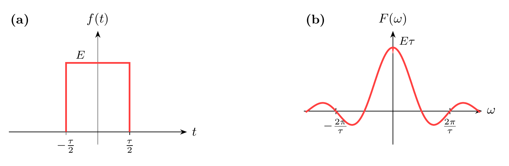
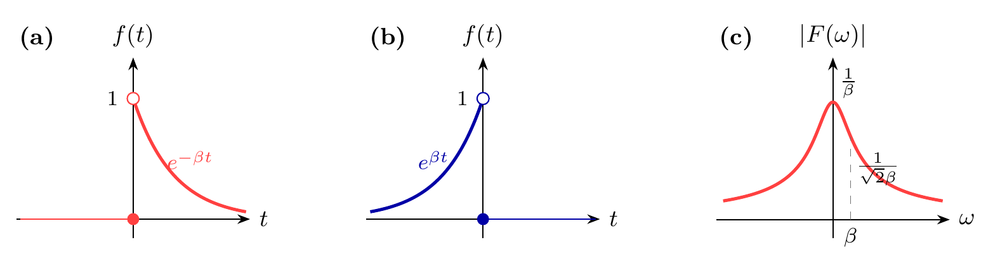
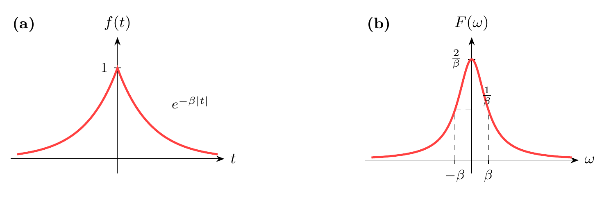
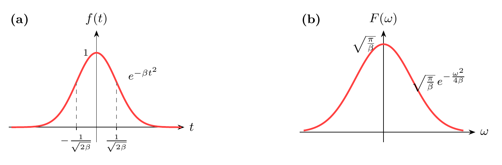
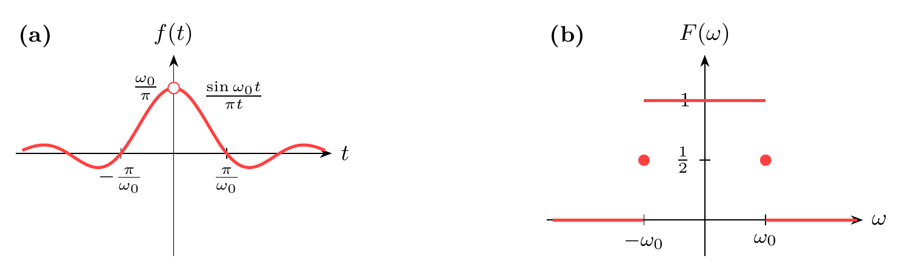

# Lecture Notes on Integral Transforms and Fourier Analysis

## Section 1 Introduction to Integral Transforms

In engineering mathematics and signal analysis, **integral transforms** constitute a foundational analytical framework, among which the **Fourier transform** and the **Laplace transform** are the most prominent.

The central idea of an integral transform is to establish a one-to-one correspondence (denoted by $f(t) \leftrightarrow F(\omega)$) between an original function $f(t)$ in the **time domain** and its image function $F(\omega)$ in the **frequency domain** via an integral operator. This correspondence converts complicated integro-differential operations in the time domain into elementary algebraic operations in the frequency domain.

### 1.1 Definition of the Fourier Transform

Let $f(t)$ be a real- or complex-valued function defined on $(-\infty, +\infty)$. Its **Fourier transform** (or image function) is defined by

$$
F(\omega) \coloneqq \mathcal{F}[f(t)] = \int_{-\infty}^{+\infty} f(t) e^{-i\omega t} \, dt.
$$

> **Remark on Notation.** In informal lecture notes, the image function is occasionally written in lowercase as $f(\omega)$, which risks confusion with the time-domain function $f(t)$. Throughout these notes, we consistently denote the time-domain function by $f(t)$, the frequency-domain transform by $F(\omega)$, and definitional equalities by $\coloneqq$.

### 1.2 Theoretical Motivation

The definition above arises naturally from the **Fourier integral formula**:

$$
f(t) = \frac{1}{2\pi} \int_{-\infty}^{+\infty} \left[ \int_{-\infty}^{+\infty} f(\tau) e^{-i\omega \tau} \, d\tau \right] e^{i\omega t} \, d\omega.
$$

> **Editorial Note.** In the original handwritten notes, the exponent in the inner integral was inadvertently written as $e^{-i\omega t} \, d\tau$. This has been corrected to $e^{-i\omega \tau} \, d\tau$, where $\tau$ serves as the dummy variable of integration. The inner bracketed integral defines $F(\omega)$, while the outer integral yields the inverse Fourier transform.

## Section 2 Fourier Series

### 2.1 Trigonometric Form and Convergence Theorem

**Theorem 2.1 (Dirichlet's Convergence Theorem for Periodic Functions).** Let $f(t)$ be a periodic function with period $T$, fundamental angular frequency $\omega_1 \coloneqq \dfrac{2\pi}{T}$, and $n$-th harmonic angular frequency $\omega_n \coloneqq n\omega_1 = \dfrac{2\pi n}{T}$. If $f(t)$ satisfies the **Dirichlet conditions** over one period, then $f(t)$ admits a convergent Fourier series expansion:

$$
f(t) \sim \frac{a_0}{2} + \sum_{n=1}^{+\infty} \left( a_n \cos \omega_n t + b_n \sin \omega_n t \right).
$$

More precisely, for every $t \in (-\infty, +\infty)$, the series converges according to

$$
\frac{a_0}{2} + \sum_{n=1}^{+\infty} \left( a_n \cos \omega_n t + b_n \sin \omega_n t \right) = \begin{cases} f(t), & \text{if } t \text{ is a point of continuity of } f(t), \\ \dfrac{f(t^-) + f(t^+)}{2}, & \text{if } t \text{ is a discontinuity of the first kind of } f(t), \end{cases}
$$

where the **Fourier coefficients** are defined by

$$
a_0 \coloneqq \frac{2}{T} \int_{-T/2}^{T/2} f(t) \, dt,
$$

$$
a_n \coloneqq \frac{2}{T} \int_{-T/2}^{T/2} f(t) \cos \omega_n t \, dt \quad (n = 1, 2, 3, \dots),
$$

$$
b_n \coloneqq \frac{2}{T} \int_{-T/2}^{T/2} f(t) \sin \omega_n t \, dt \quad (n = 1, 2, 3, \dots).
$$

### 2.2 Remarks on Dirichlet Conditions, Orthogonality, and Complex Exponential Form

* **Remark 2.1 (Dirichlet Conditions).** A $T$-periodic function $f(t)$ is said to satisfy the Dirichlet conditions if, on a single period $\left[-\dfrac{T}{2}, \dfrac{T}{2}\right]$, it fulfills the following two criteria:
  1. $f(t)$ is continuous, or possesses at most finitely many **discontinuities of the first kind** (i.e., points at which both the left-hand limit $f(t^-)$ and the right-hand limit $f(t^+)$ exist and are finite);
  2. $f(t)$ has at most finitely many **local extrema** (maxima and minima).

  *(Note: Condition 1 implies that $f(t)$ is bounded and absolutely integrable over one period, i.e., $\int_{-T/2}^{T/2} |f(t)| \, dt < +\infty$, thereby ensuring the existence of the Fourier coefficients.)*

* **Remark 2.2 (Trigonometric Orthogonal Basis).** The trigonometric system

  $$
  \left\{ 1, \, \cos \omega_1 t, \, \sin \omega_1 t, \, \cos \omega_2 t, \, \sin \omega_2 t, \, \dots, \, \cos \omega_n t, \, \sin \omega_n t, \, \dots \right\}
  $$

  is mutually orthogonal on the interval $\left[-\dfrac{T}{2}, \dfrac{T}{2}\right]$ and forms a complete **orthogonal basis** for the space of square-integrable functions $L^2\left[-\dfrac{T}{2}, \dfrac{T}{2}\right]$.

* **Remark 2.3 (Complex Exponential Form and Orthogonal Basis).** Applying Euler's identity,

  $$
  e^{\pm i\omega_n t} \equiv \cos \omega_n t \pm i \sin \omega_n t,
  $$

  we obtain $\cos \omega_n t \equiv \dfrac{e^{i\omega_n t} + e^{-i\omega_n t}}{2}$ and $\sin \omega_n t \equiv \dfrac{e^{i\omega_n t} - e^{-i\omega_n t}}{2i}$. Consequently, the complex exponential system $\left\{ e^{i\omega_n t} \right\}_{n=-\infty}^{+\infty}$ also constitutes a complete orthogonal basis on $\left[-\dfrac{T}{2}, \dfrac{T}{2}\right]$. Substituting these identities into the trigonometric series yields the **complex exponential Fourier series**:

  $$
  f(t) = \sum_{n=-\infty}^{+\infty} c_n e^{i\omega_n t},
  $$

  where the complex Fourier coefficients $c_n$ are defined by

  $$
  c_n \coloneqq \frac{1}{T} \int_{-T/2}^{T/2} f(\tau) e^{-i\omega_n \tau} \, d\tau \quad (n = 0, \pm 1, \pm 2, \dots),
  $$

  which are related to the trigonometric coefficients via $c_0 = \dfrac{a_0}{2}$, $c_n = \dfrac{a_n - i b_n}{2}$, and $c_{-n} = \dfrac{a_n + i b_n}{2}$ for $n \ge 1$. Substituting $c_n$ back into the series gives

  $$
  f(t) = \frac{1}{T} \sum_{n=-\infty}^{+\infty} \left[ \int_{-T/2}^{T/2} f(\tau) e^{-i\omega_n \tau} \, d\tau \right] e^{i\omega_n t}.
  $$

## Section 3 The Fourier Integral Theorem and Fourier Integral Formula

### 3.1 Heuristic Derivation from Periodic to Aperiodic Functions

Consider an aperiodic function $f(t)$ defined on $(-\infty, +\infty)$. We may view $f(t)$ as the limiting case of a $T$-periodic function $f_T(t)$ as $T \to +\infty$, where $f_T(t)$ is constructed to satisfy the identity

$$
f_T(t) \equiv f(t), \quad t \in \left(-\frac{T}{2}, \frac{T}{2}\right).
$$

In the complex Fourier series of $f_T(t)$, the angular frequency spacing between adjacent harmonics is

$$
\Delta \omega \coloneqq \omega_n - \omega_{n-1} = \frac{2\pi}{T} \implies \frac{1}{T} = \frac{\Delta \omega}{2\pi}.
$$

Substituting $\dfrac{1}{T} = \dfrac{\Delta \omega}{2\pi}$ into the complex Fourier series representation of $f_T(t)$ yields

$$
f_T(t) = \frac{1}{2\pi} \sum_{n=-\infty}^{+\infty} \left[ \int_{-T/2}^{T/2} f_T(\tau) e^{-i\omega_n \tau} \, d\tau \right] e^{i\omega_n t} \Delta \omega.
$$

Passing formally to the limit as $T \to +\infty$, the spectral spacing satisfies $\Delta \omega \to 0$, the discrete frequencies $\omega_n = n \Delta \omega$ become a continuous angular frequency variable $\omega$, and the Riemann sum transitions into an improper integral, giving the **Fourier integral formula**:

$$
f(t) = \frac{1}{2\pi} \int_{-\infty}^{+\infty} \left[ \int_{-\infty}^{+\infty} f(\tau) e^{-i\omega \tau} \, d\tau \right] e^{i\omega t} \, d\omega.
$$

### 3.2 The Fourier Integral Theorem and Formula

**Theorem 3.1 (Fourier Integral Theorem).** Suppose that an aperiodic function $f(t)$ defined on $(-\infty, +\infty)$ satisfies the following two conditions:
1. $f(t)$ satisfies the **Dirichlet conditions** on every finite interval;
2. $f(t)$ is **absolutely integrable** on $(-\infty, +\infty)$, that is,

$$
\int_{-\infty}^{+\infty} |f(t)| \, dt < +\infty.
$$

Then, for every $t \in (-\infty, +\infty)$, the **Fourier integral formula** (in complex exponential form) holds:

$$
\frac{1}{2\pi} \int_{-\infty}^{+\infty} \left[ \int_{-\infty}^{+\infty} f(\tau) e^{-i\omega \tau} \, d\tau \right] e^{i\omega t} \, d\omega = \begin{cases} f(t), & \text{if } t \text{ is a point of continuity of } f(t), \\ \dfrac{f(t^-) + f(t^+)}{2}, & \text{if } t \text{ is a discontinuity of the first kind of } f(t). \end{cases}
$$

Moreover, applying Euler's identity $e^{i\omega(t-\tau)} \equiv \cos\omega(t-\tau) + i\sin\omega(t-\tau)$ and noting that $\cos\omega(t-\tau)$ is even in $\omega$ whereas $\sin\omega(t-\tau)$ is odd in $\omega$, we obtain the **trigonometric form** of the Fourier integral formula at every point of continuity of $f(t)$:

$$
f(t) = \frac{1}{\pi} \int_{0}^{+\infty} \left[ \int_{-\infty}^{+\infty} f(\tau) \cos\omega(t-\tau) \, d\tau \right] d\omega.
$$

### 3.3 Illustrative Examples

#### Example 3.1 (Two-Sided Exponential Decay Function)

Let the two-sided exponential decay function be defined by

$$
f(t) \coloneqq e^{-\beta |t|} \quad (\beta > 0).
$$

Determine its Fourier integral representation and deduce the value of the parametric improper integral $\int_{-\infty}^{+\infty} \dfrac{2\beta}{\omega^2 + \beta^2} e^{i\omega t} \, d\omega$.

**Proof.**
1. **Verification of Hypotheses.** The function $f(t) = e^{-\beta |t|}$ is continuous everywhere on $(-\infty, +\infty)$, possesses a single local maximum at $t = 0$, and is absolutely integrable on $(-\infty, +\infty)$:

   $$
   \int_{-\infty}^{+\infty} \left| e^{-\beta |t|} \right| dt = 2 \int_{0}^{+\infty} e^{-\beta t} \, dt = \frac{2}{\beta} < +\infty.
   $$

   Hence, the Fourier integral formula holds for all $t \in (-\infty, +\infty)$.

2. **Evaluation of the Inner Integral.** Splitting the integral at $t = 0$, we compute

   $$
   \begin{aligned}
   F(\omega) &= \int_{-\infty}^{+\infty} e^{-\beta |t|} e^{-i\omega t} \, dt \\
   &= \int_{-\infty}^{0} e^{(\beta - i\omega)t} \, dt + \int_{0}^{+\infty} e^{(-\beta - i\omega)t} \, dt.
   \end{aligned}
   $$

   Since $\beta > 0$ and $\left| e^{\pm i\omega t} \right| \equiv 1$, we have $\lim_{t \to -\infty} e^{(\beta - i\omega)t} = 0$ and $\lim_{t \to +\infty} e^{(-\beta - i\omega)t} = 0$. Consequently,

   $$
   \begin{aligned}
   F(\omega) &= \left. \frac{e^{(\beta - i\omega)t}}{\beta - i\omega} \right|_{-\infty}^{0} + \left. \frac{e^{(-\beta - i\omega)t}}{-\beta - i\omega} \right|_{0}^{+\infty} \\
   &= \frac{1}{\beta - i\omega} + \frac{1}{\beta + i\omega} \\
   &= \frac{2\beta}{\omega^2 + \beta^2}.
   \end{aligned}
   $$

3. **Application of the Fourier Integral Formula.** Because $f(t) = e^{-\beta |t|}$ is continuous everywhere, Theorem 3.1 yields

   $$
   e^{-\beta |t|} = \frac{1}{2\pi} \int_{-\infty}^{+\infty} \frac{2\beta}{\omega^2 + \beta^2} e^{i\omega t} \, d\omega.
   $$

   Multiplying both sides by $2\pi$, we establish the identity

   $$
   \int_{-\infty}^{+\infty} \frac{2\beta}{\omega^2 + \beta^2} e^{i\omega t} \, d\omega = 2\pi e^{-\beta |t|} \quad (\beta > 0).
   $$

   *(Editorial Note: The absolute value bars around $t$ on the right-hand side were omitted in the original handwritten notes and have been restored above. Note also that this improper integral can alternatively be evaluated via the residue theorem in complex analysis.)*

#### Example 3.2 (Unit Rectangular Pulse and the Dirichlet Integral)

Let the unit rectangular pulse function be defined by

$$
f(t) \coloneqq \begin{cases} 1, & |t| < 1, \\ 0, & |t| > 1. \end{cases}
$$

Find the Fourier integral representation of $f(t)$ and exploit its convergence behavior at a point of discontinuity to evaluate the **Dirichlet integral** $\int_{0}^{+\infty} \dfrac{\sin x}{x} \, dx$.

**Proof.**
1. **Evaluation of the Inner Integral.** Clearly, $f(t)$ satisfies the Dirichlet conditions on every finite interval and is absolutely integrable on $(-\infty, +\infty)$ since $\int_{-\infty}^{+\infty} |f(t)| \, dt = 2 < +\infty$. For $\omega \neq 0$, we have

   $$
   \begin{aligned}
   F(\omega) &= \int_{-\infty}^{+\infty} f(t) e^{-i\omega t} \, dt = \int_{-1}^{1} 1 \cdot e^{-i\omega t} \, dt \\
   &= \left. \frac{e^{-i\omega t}}{-i\omega} \right|_{-1}^{1} = \frac{e^{-i\omega} - e^{i\omega}}{-i\omega} = \frac{2\sin \omega}{\omega}.
   \end{aligned}
   $$

   For $\omega = 0$, the integral evaluates directly to $F(0) = \int_{-1}^{1} 1 \, dt = 2$, which agrees with the removable limit as $\omega \to 0$.

2. **Fourier Integral Representation.** By Theorem 3.1, at the points of continuity $t \neq \pm 1$ and at the discontinuities of the first kind $t = \pm 1$, we obtain

   $$
   \frac{1}{2\pi} \int_{-\infty}^{+\infty} \frac{2\sin \omega}{\omega} e^{i\omega t} \, d\omega = \begin{cases} f(t), & t \neq \pm 1, \\ \dfrac{f(1^-) + f(1^+)}{2} = \dfrac{1 + 0}{2} = \dfrac{1}{2}, & t = \pm 1. \end{cases}
   $$

3. **Evaluation of the Dirichlet Integral.** Evaluating the representation at the jump discontinuity $t = 1$ gives

   $$
   \frac{1}{2\pi} \int_{-\infty}^{+\infty} \frac{2\sin \omega}{\omega} e^{i\omega} \, d\omega = \frac{1}{2}.
   $$

   Expanding $e^{i\omega} \equiv \cos \omega + i\sin \omega$, we observe that $\dfrac{2\sin \omega \cos \omega}{\omega}$ is even in $\omega$, while $\dfrac{2\sin^2 \omega}{\omega}$ is odd in $\omega$ (so its Cauchy principal value integral over $(-\infty, +\infty)$ vanishes). Hence,

   $$
   \frac{1}{2\pi} \cdot 2 \int_{0}^{+\infty} \frac{2\sin \omega \cos \omega}{\omega} \, d\omega = \frac{1}{2} \implies \frac{1}{\pi} \int_{0}^{+\infty} \frac{\sin 2\omega}{\omega} \, d\omega = \frac{1}{2},
   $$

   which simplifies to

   $$
   \int_{0}^{+\infty} \frac{\sin 2\omega}{\omega} \, d\omega = \frac{\pi}{2}.
   $$

   Applying the change of variables $x = 2\omega$ ($dx = 2\,d\omega$), we obtain the **Dirichlet integral**:

   $$
   \int_{0}^{+\infty} \frac{\sin x}{x} \, dx = \frac{\pi}{2}.
   $$

## Section 4 The Fourier Transform and Common Transform Pairs

### 4.1 Definitions of the Fourier Transform and Inverse Fourier Transform

**Definition 4.1 (Fourier Transform Pair).** Let $f(t)$ satisfy the Dirichlet conditions on every finite interval and be absolutely integrable on $(-\infty, +\infty)$. We define the **Fourier transform** and **inverse Fourier transform** as the pair of mutually inverse integral operators:

* **Fourier Transform:**

  $$
  F(\omega) \coloneqq \mathcal{F}[f(t)] = \int_{-\infty}^{+\infty} f(t) e^{-i\omega t} \, dt,
  $$

* **Inverse Fourier Transform:**

  $$
  f(t) \coloneqq \mathcal{F}^{-1}[F(\omega)] = \frac{1}{2\pi} \int_{-\infty}^{+\infty} F(\omega) e^{i\omega t} \, d\omega.
  $$

  *(Note: At any discontinuity of the first kind of $f(t)$, the inverse Fourier transform integral converges to the arithmetic mean $\dfrac{f(t^-) + f(t^+)}{2}$.)*

When $f(t)$ and $F(\omega)$ satisfy these relations, they are said to form a **Fourier transform pair**, written symbolically as

$$
f(t) \longleftrightarrow F(\omega).
$$

### 4.2 Common Fourier Transform Pairs

Below is a summary of fundamental Fourier transform pairs frequently encountered in engineering mathematics and signal processing, accompanied by derivations and figure placeholders.

#### (1) Rectangular Pulse Function (Gate Function)

* **Transform Pair** ($E > 0, \, \tau > 0$):

  $$
  f(t) = \begin{cases} E, & |t| \le \dfrac{\tau}{2}, \\ 0, & |t| > \dfrac{\tau}{2} \end{cases} \quad \longleftrightarrow \quad F(\omega) = \begin{cases} 2E \dfrac{\sin\left(\dfrac{\omega \tau}{2}\right)}{\omega} = E\tau \, \mathrm{Sa}\left(\dfrac{\omega \tau}{2}\right), & \omega \neq 0, \\ E\tau, & \omega = 0, \end{cases}
  $$

  where the sampling function is defined by $\mathrm{Sa}(x) \coloneqq \dfrac{\sin x}{x}$.

#### (2) One-Sided Exponential Decay Functions

* **Causal (Right-Sided) Exponential Decay** ($\beta > 0$):

  $$
  f(t) = \begin{cases} e^{-\beta t}, & t > 0, \\ 0, & t < 0 \end{cases} \quad \longleftrightarrow \quad F(\omega) = \frac{1}{\beta + i\omega}.
  $$

* **Anti-Causal (Left-Sided) Exponential Decay** ($\beta > 0$):

  $$
  f(t) = \begin{cases} 0, & t > 0, \\ e^{\beta t}, & t < 0 \end{cases} \quad \longleftrightarrow \quad F(\omega) = \frac{1}{\beta - i\omega}.
  $$

#### (3) Two-Sided Exponential Decay Function

* **Transform Pair** ($\beta > 0$):

  $$
  f(t) = e^{-\beta |t|} \quad \longleftrightarrow \quad F(\omega) = \frac{2\beta}{\beta^2 + \omega^2}.
  $$

#### (4) Gaussian Pulse Function (Bell-Shaped Pulse)

* **Transform Pair** ($\beta > 0$):

  $$
  f(t) = e^{-\beta t^2} \quad \longleftrightarrow \quad F(\omega) = \sqrt{\frac{\pi}{\beta}} e^{-\frac{\omega^2}{4\beta}}.
  $$

**Proof.** Completing the square in the exponent of the defining integral gives

$$
\begin{aligned}
F(\omega) &= \int_{-\infty}^{+\infty} e^{-\beta t^2} e^{-i\omega t} \, dt \\
&= \int_{-\infty}^{+\infty} \exp\left\{ -\beta \left[ t^2 + \frac{i\omega}{\beta}t + \left(\frac{i\omega}{2\beta}\right)^2 - \left(\frac{i\omega}{2\beta}\right)^2 \right] \right\} dt \\
&= e^{-\frac{\omega^2}{4\beta}} \int_{-\infty}^{+\infty} e^{-\beta \left(t + \frac{i\omega}{2\beta}\right)^2} \, dt.
\end{aligned}
$$

*(Editorial Note: In the original handwritten notes, the squared term after completing the square was written as $\left(t + \dfrac{i\omega}{\beta}\right)^2$; this has been corrected to $\left(t + \dfrac{i\omega}{2\beta}\right)^2$.)*

By Cauchy's integral theorem in the complex plane, shifting the horizontal contour of integration vertically does not alter the value of the Gaussian integral. Combining this contour invariance with the standard Gaussian integral $\int_{-\infty}^{+\infty} e^{-\beta u^2} \, du = \sqrt{\dfrac{\pi}{\beta}}$, we obtain

$$
\int_{-\infty}^{+\infty} e^{-\beta \left(t + \frac{i\omega}{2\beta}\right)^2} \, dt = \int_{-\infty}^{+\infty} e^{-\beta u^2} \, du = \sqrt{\frac{\pi}{\beta}},
$$

and therefore

$$
F(\omega) = \sqrt{\frac{\pi}{\beta}} e^{-\frac{\omega^2}{4\beta}}.
$$

#### (5) Sampling Function (Impulse Response of an Ideal Low-Pass Filter)

* **Transform Pair** ($\omega_0 > 0$):

  $$
  f(t) = \frac{\sin \omega_0 t}{\pi t} \quad \longleftrightarrow \quad F(\omega) = \begin{cases} 1, & |\omega| < \omega_0, \\ \dfrac{1}{2}, & |\omega| = \omega_0, \\ 0, & |\omega| > \omega_0. \end{cases}
  $$

  *(Editorial Note: The original handwritten notes grouped the boundary points $|\omega| = \omega_0$ with the case $F(\omega) = 1$. Strictly speaking, at the spectral jump discontinuities $\omega = \pm \omega_0$, the Fourier transform integral converges to the midpoint value $\dfrac{1}{2}$.)*

**Proof.** Expanding $e^{-i\omega t} \equiv \cos \omega t - i\sin \omega t$ in the Fourier transform integral, we have

$$
\begin{aligned}
F(\omega) &= \int_{-\infty}^{+\infty} \frac{\sin \omega_0 t}{\pi t} e^{-i\omega t} \, dt \\
&= \int_{-\infty}^{+\infty} \frac{\sin \omega_0 t}{\pi t} (\cos \omega t - i\sin \omega t) \, dt.
\end{aligned}
$$

Since $\dfrac{\sin \omega_0 t}{\pi t} \cos \omega t$ is an even function of $t$ and $\dfrac{\sin \omega_0 t}{\pi t} \sin \omega t$ is an odd function of $t$, applying the product-to-sum identity $\sin \omega_0 t \cos \omega t \equiv \dfrac{1}{2}\left[\sin(\omega_0 + \omega)t + \sin(\omega_0 - \omega)t\right]$ yields

$$
\begin{aligned}
F(\omega) &= \int_{-\infty}^{+\infty} \frac{\sin \omega_0 t \cos \omega t}{\pi t} \, dt \\
&= \frac{1}{2\pi} \int_{-\infty}^{+\infty} \frac{\sin(\omega_0 + \omega)t + \sin(\omega_0 - \omega)t}{t} \, dt \\
&= \frac{1}{\pi} \left[ \int_{0}^{+\infty} \frac{\sin(\omega_0 + \omega)t}{t} \, dt + \int_{0}^{+\infty} \frac{\sin(\omega_0 - \omega)t}{t} \, dt \right].
\end{aligned}
$$

Recall the generalized Dirichlet integral formula:

$$
\int_{0}^{+\infty} \frac{\sin kt}{t} \, dt = \begin{cases} \dfrac{\pi}{2}, & k > 0, \\ 0, & k = 0, \\ -\dfrac{\pi}{2}, & k < 0. \end{cases}
$$

Given $\omega_0 > 0$, we distinguish three cases:

1. **Case 1 ($|\omega| < \omega_0$):** Both $\omega_0 + \omega > 0$ and $\omega_0 - \omega > 0$, so

   $$
   F(\omega) = \frac{1}{\pi}\left(\frac{\pi}{2} + \frac{\pi}{2}\right) = 1.
   $$

2. **Case 2 ($|\omega| = \omega_0$):** One of $\omega_0 + \omega$ and $\omega_0 - \omega$ equals $0$ while the other equals $2\omega_0 > 0$, so

   $$
   F(\omega) = \frac{1}{\pi}\left(\frac{\pi}{2} + 0\right) = \frac{1}{2}.
   $$

3. **Case 3 ($|\omega| > \omega_0$):** The quantities $\omega_0 + \omega$ and $\omega_0 - \omega$ have opposite signs, so

   $$
   F(\omega) = \frac{1}{\pi}\left(\frac{\pi}{2} - \frac{\pi}{2}\right) = 0.
   $$